<p align="center">
  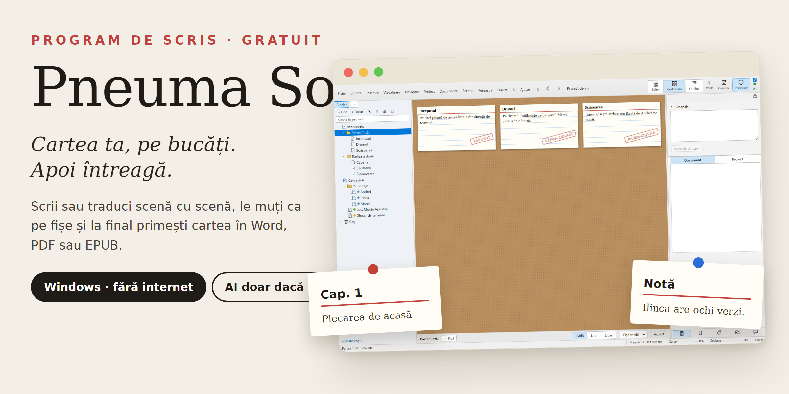
</p>

<p align="center">
  <a href="../../releases/latest"><strong>Descarcă pentru Windows</strong></a> ·
  <a href="#cum-îl-instalezi">Instalare</a> ·
  <a href="#întrebări">Întrebări</a> ·
  <a href="#sub-capotă">Sub capotă</a>
</p>

Un roman, o traducere sau o teză într-un singur fișier Word de 300 de pagini devine greu de stăpânit. În Scribner textul stă pe bucăți mici, câte una pentru fiecare scenă sau capitol. Le vezi, le muți și le găsești ușor. Când ai terminat, apeși un buton și primești cartea întreagă.

<p align="center">
  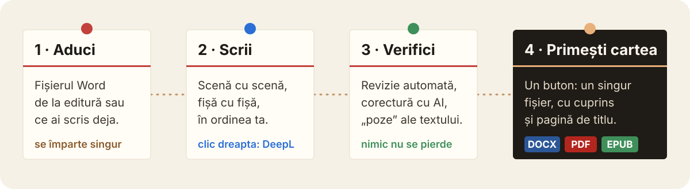
</p>

<p align="center">
  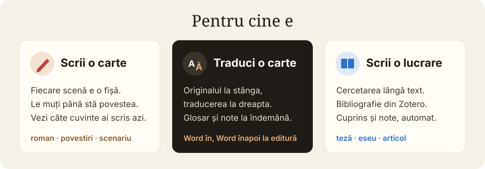
</p>

## Pentru traducători

<p align="center">
  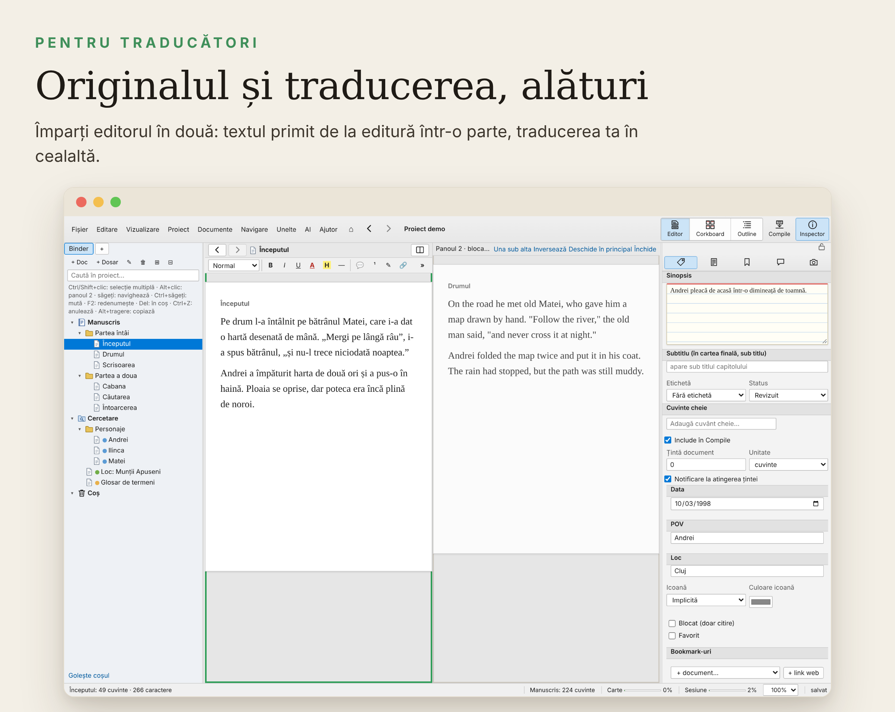
</p>

Pui fișierul Word primit de la editură și Scribner îl împarte pe capitole. Ții originalul într-o parte și traducerea în cealaltă. La final trimiți înapoi un singur fișier Word, cu notele de subsol la locul lor.

<p align="center">
  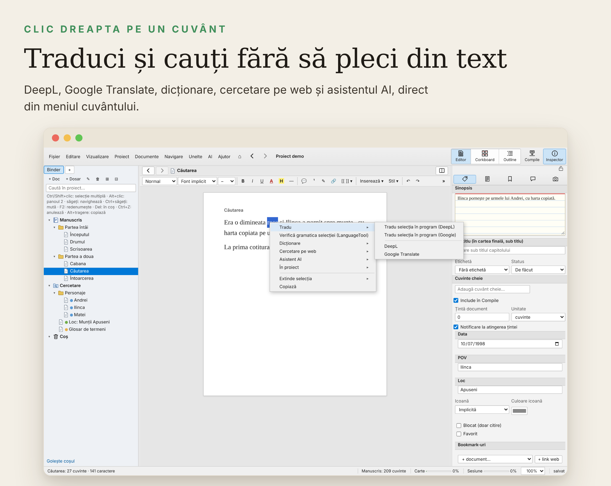
</p>

Clic dreapta pe un cuvânt și ai la îndemână:

- **Traduce:** DeepL sau Google Translate, pe cuvânt, pe frază sau pe un paragraf întreg. Cu cheia ta DeepL, traducerea apare direct în program și o pui în text cu un clic.
- **Dicționare:** dexonline și sinonime, Wiktionary, Cambridge, Merriam-Webster, Linguee cu exemple traduse, IATE pentru terminologia UE.
- **Asistent AI:** cercetare despre termen, explicație, corectură sau traducere, cu înainte și după.
- **În proiect:** caută termenul în toată cartea și în notele tale sau pune-l în glosar.
- **NotebookLM:** întrebi despre termen în sursele tale.

Nu trebuie să selectezi nimic înainte: clic dreapta pe un cuvânt îl selectează singur, iar meniul extinde selecția la frază sau la paragraf.

## Pentru scriitori

<p align="center">
  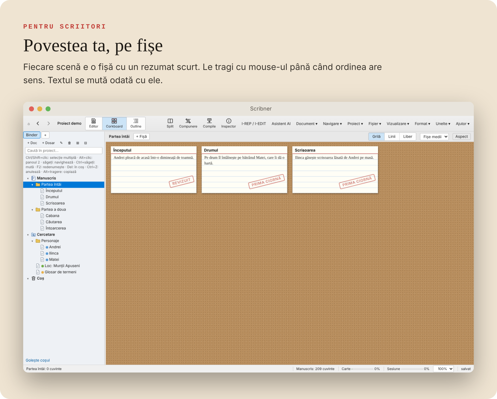
</p>

Fiecare scenă are fișa ei, cu un rezumat de două rânduri. O muți cu mouse-ul și textul se mută odată cu ea. Îți pui o țintă, de exemplu 1.000 de cuvinte pe zi, și vezi cât ai scris.

<p align="center">
  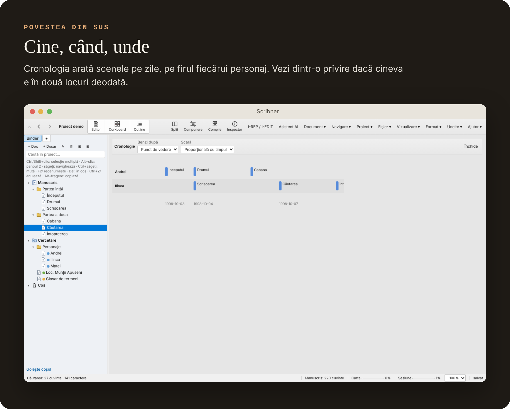
</p>

Personajele, locurile și cercetarea stau lângă text. Cronologia îți arată pe zile cine unde e, ca să prinzi contradicțiile înainte de editor.

O pagină web pusă în Cercetare se salvează cu tot cu imagini, așa că o citești și fără internet. *Vizualizare → Focus lingvistic* îți colorează substantivele sau verbele, ca să vezi unde se îngroașă textul.

## Interfață pe gustul tău

<p align="center">
  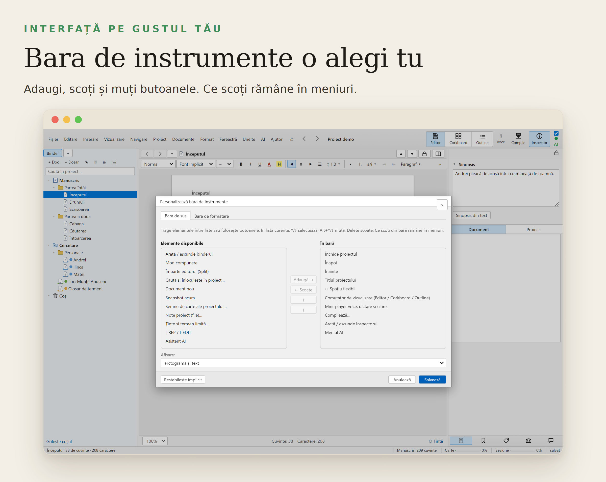
</p>

Sus vezi doar ce folosești des: meniurile, titlul, Editor / Corkboard / Outline, Compile și Inspector. Restul stă în meniuri ordonate: Fișier, Editare, Vizualizare, Proiect, Documente, Navigare, Unelte, AI și Ajutor.

Din *Vizualizare → Personalizează bara de instrumente* alegi singur butoanele, pentru bara de sus și pentru bara de formatare. Le adaugi, le scoți, le muți cu mouse-ul. Ce scoți din bară rămâne în meniuri. Dacă te-ai încurcat, apeși „Restabilește implicit”.

<p align="center">
  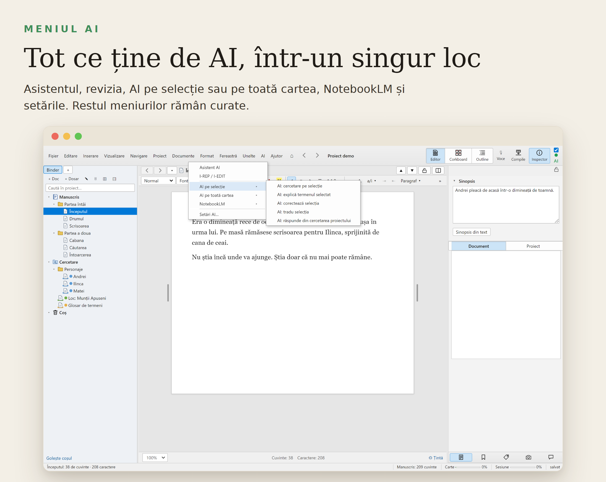
</p>

Tot ce ține de AI stă într-un singur meniu: asistentul, revizia, AI pe selecție sau pe toată cartea, NotebookLM și setările. Dacă oprești AI-ul, în meniu rămân doar revizia fără AI și setările.

<p align="center">
  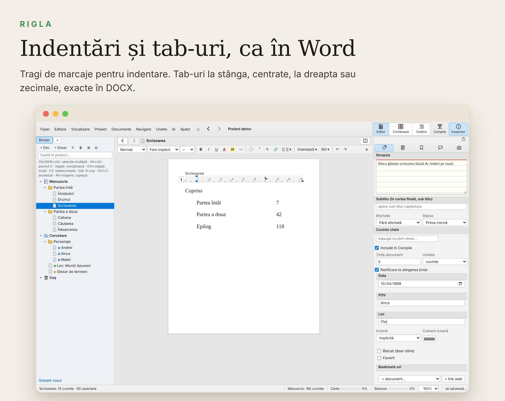
</p>

Rigla (*Editare → Format → Arată / ascunde rigla* sau Ctrl+Alt+Shift+R) îți arată indentările și tab-urile. Tragi de marcaje ca în Word. Un clic pe riglă pune un tab: la stânga, centrat, la dreapta sau zecimal, pentru cifre aliniate la virgulă. În Word iese exact la fel.

## Corectezi fără grijă

<p align="center">
  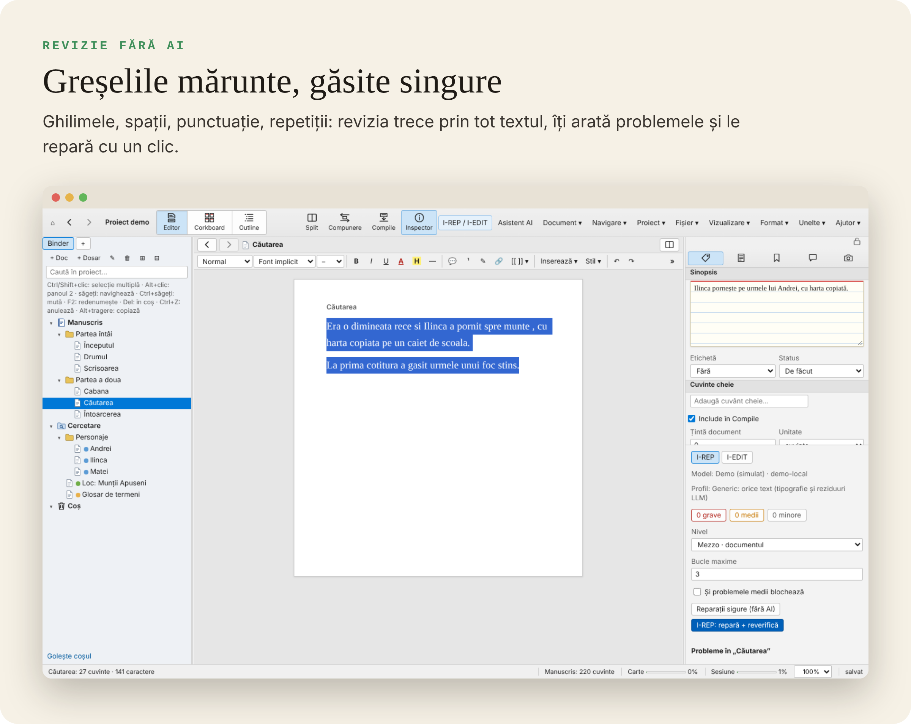
</p>

Revizia automată, fără AI, găsește ghilimelele greșite, spațiile duble, punctuația și repetițiile, apoi le repară cu un clic.

**Corecturi învățate.** Când corectezi de mână un cuvânt subliniat, programul ține minte. Data viitoare îl corectează singur, cu majusculele la locul lor. Cuvintele străine și transliterările (de exemplu cele în IAST) nu sunt atinse.

<p align="center">
  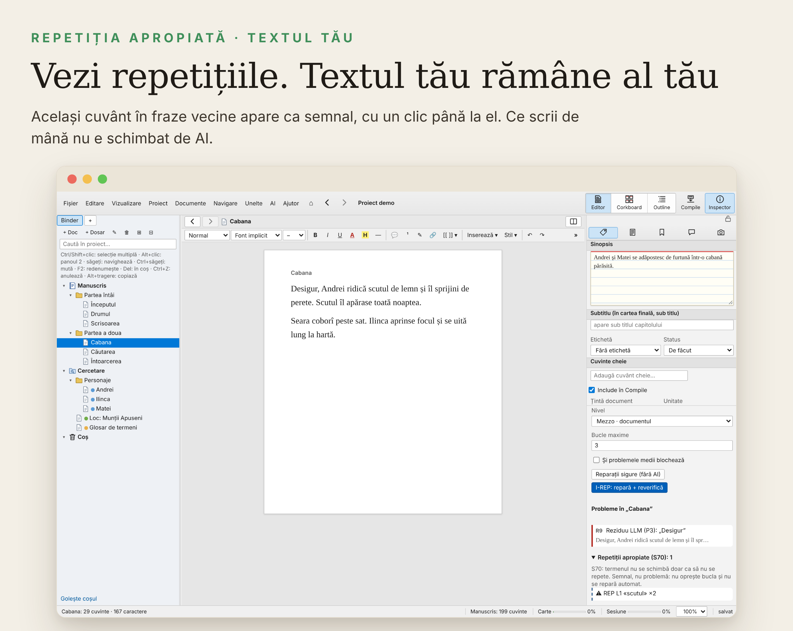
</p>

**Repetiția apropiată.** Același cuvânt în aceeași frază sau în fraza vecină apare ca semnal: `⚠ REP L1 «scutul» ×2`. Un clic te duce la el. Nu e o greșeală și nu se repară automat; tu hotărăști dacă supără.

**Textul tău e protejat.** Ce scrii de mână devine text al autorului. Revizia cu AI nu schimbă, nu mută și nu șterge niciun paragraf scris de tine. Dacă vede ceva acolo, doar îți semnalează, iar toate modificările tale se notează.

<p align="center">
  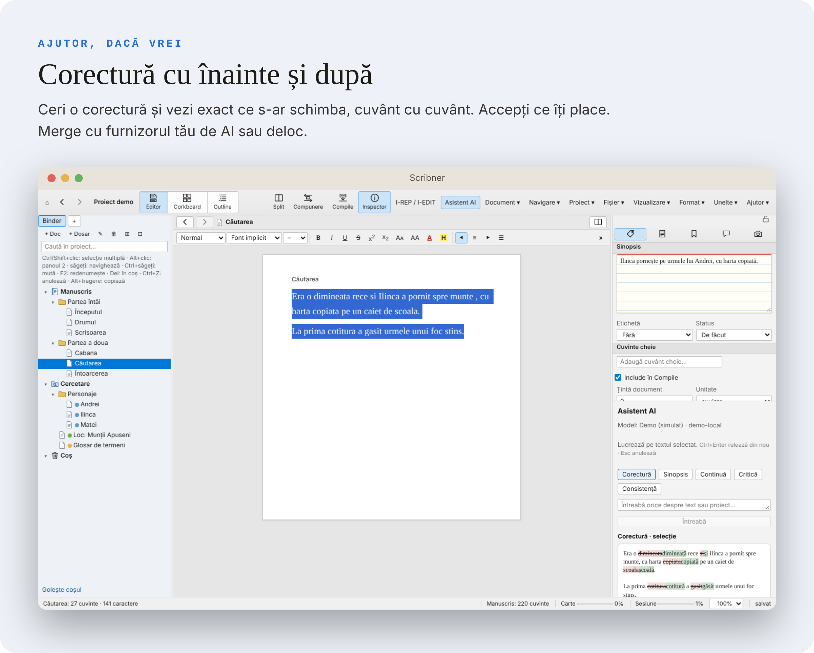
</p>

Dacă vrei, asistentul AI face corectură, rezumate sau o a doua părere. Vezi exact ce schimbă și accepți doar ce îți place. Merge cu furnizorul tău: Anthropic, OpenAI, Google Gemini, NVIDIA NIM, OpenRouter și alții, sau un model care rulează pe calculatorul tău. Poți opri AI-ul complet din Setări.

<p align="center">
  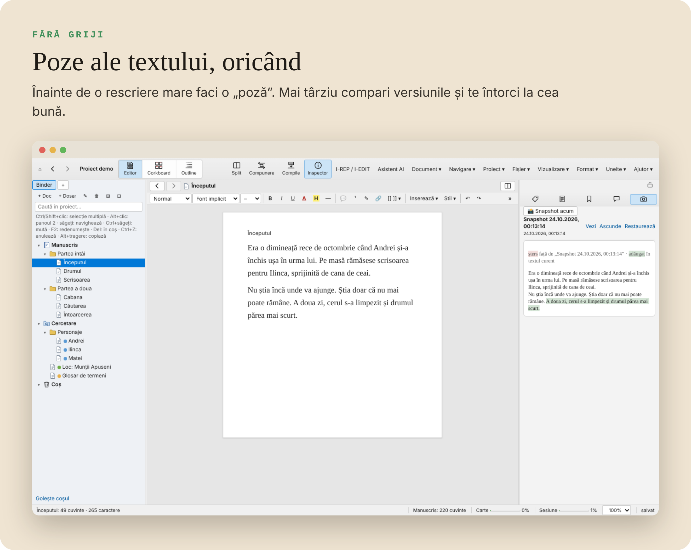
</p>

Înainte de o rescriere mare faci o „poză” a textului. Mai târziu compari versiunile și te întorci la cea bună. Totul se salvează singur, iar copiile de siguranță se fac automat.

## Același proiect, oriunde

<p align="center">
  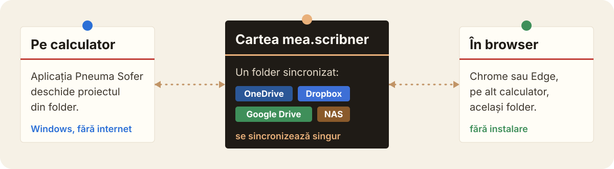
</p>

Pui folderul proiectului în OneDrive, Dropbox, Google Drive sau pe un NAS. Pe calculatorul tău îl deschizi din aplicație. Pe alt calculator îl deschizi în Chrome sau Edge, cu „Deschide proiect .scribner”, fără să instalezi nimic. Ce scrii într-o parte apare în cealaltă în câteva secunde. Doar nu lucra la același document în două locuri deodată.

## Legătura cu Claude, Codex și alți agenți AI

Dacă lucrezi cu un agent AI, îl poți lăsa să lucreze direct în proiect: să citească capitolele, să scrie sinopsisuri, să caute, să facă revizia sau Compile. Din meniul *AI → Conectează la Claude (MCP)* configurezi Claude Desktop cu un clic sau copiezi comanda pentru Claude Code. Nu ai nevoie de Node.js: programul instalat pornește singur legătura.

Merge și cu Codex, Gemini CLI, Cursor, VS Code și alți clienți MCP. Comenzile exacte, cu căile tale, sunt în *Ajutor → „Ce faci tu”*. Înainte de fiecare modificare a agentului se face o copie, iar tot ce face se notează.

## La final, cartea întreagă

<p align="center">
  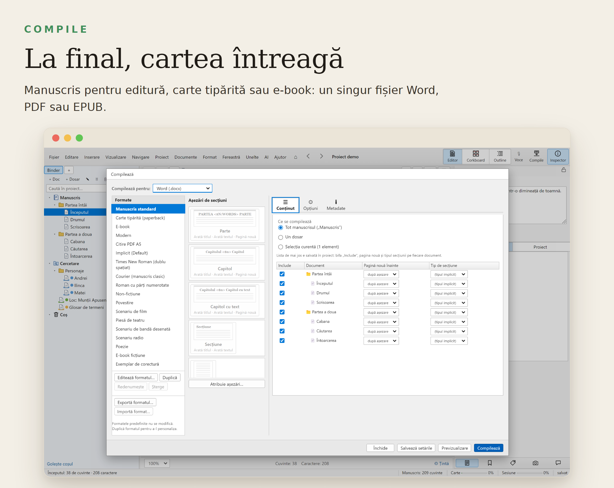
</p>

Alegi forma: manuscris pentru editură, carte tipărită sau e-book. Scribner adună bucățile într-un singur fișier Word, PDF sau EPUB, cu copertă, pagină de titlu și subtitlu, cuprins și capitole numerotate. Imaginile rămân cât le-ai făcut în text, fără să iasă din pagină; textul se desparte în silabe și nu lasă rânduri singure la capăt de pagină. Fișierele trec verificările programelor care le deschid: Word, LibreOffice, cititoarele de e-book.

<p align="center">
  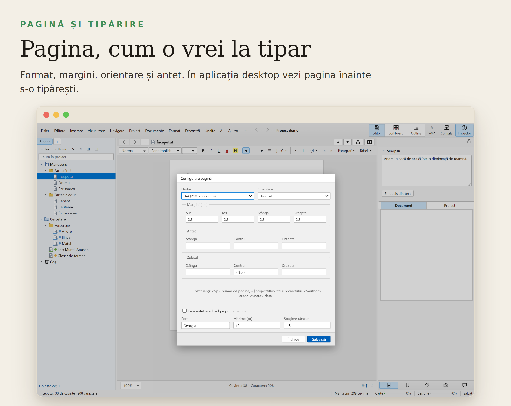
</p>

Vrei doar câteva pagini pe hârtie? *Fișier → Tipărire → Configurare pagină* alege formatul, marginile, antetul și subsolul. În aplicația desktop, *Previzualizare tipărire* îți arată paginile înainte să le trimiți la imprimantă.

## Cum îl instalezi

Din pagina [Releases](../../releases/latest) descarci una dintre variante:

- **`Scribner-Setup-<versiune>.exe`** e programul de instalare, cu wizard în română. Alegi folderul, primești scurtătură pe Desktop și în meniul Start, iar la final programul pornește. Nu cere drepturi de administrator; programul se pune în `AppData\Local\Programs\Scribner`. La dezinstalare, cărțile tale rămân.
- **`Scribner-<versiune>-portabil.exe`** merge fără instalare, de oriunde, chiar de pe stick.

O versiune nouă apare în Releases de fiecare dată când iese, automat.

La prima pornire, deschide **Tutorialul interactiv** din ecranul de start: 15 lecții scurte, în care înveți lucrând. Manualul complet se deschide oricând cu F1.

## Întrebări

**Am nevoie de internet?** Nu. Scribner merge pe calculatorul tău și textele rămân la tine. Internetul îți trebuie doar pentru DeepL, dicționarele online și AI.

**Pot aduce ce am scris deja?** Da: Word, RTF, ODT, Markdown, pagini web, scenarii Fountain sau Final Draft și proiecte `.scriv`.

**Trebuie să folosesc AI?** Nu. Programul e complet fără el.

**Pot folosi DeepL, LanguageTool sau Speechify cu contul meu?** Da. În Setări → Servicii și conturi pui cheile: traduci în program cu DeepL sau Google, verifici gramatica cu LanguageTool, asculți textul cu vocile Speechify. Tot acolo îți ții și alte conturi cu parolă. Totul se păstrează criptat pe calculatorul tău. Pentru AI pui cheia în *AI → Setări AI*: Anthropic, OpenAI, Gemini, NVIDIA NIM, OpenRouter și alții; unele au și modele gratuite.

**Pot lucra și din browser sau de pe alt calculator?** Da. Pune proiectul într-un folder OneDrive, Dropbox, Google Drive sau pe un NAS și deschide-l în Chrome sau Edge. Vezi [Același proiect, oriunde](#același-proiect-oriunde).

**Pot lega un agent AI, ca Claude sau Codex?** Da, prin *AI → Conectează la Claude (MCP)*, fără Node.js. Pentru Codex, Gemini CLI, Cursor sau VS Code, comenzile sunt în *Ajutor → „Ce faci tu”*.

**În ce limbă e?** Română sau engleză, la alegere.

**Cât costă?** Nimic. E gratuit și cu cod deschis.

## Sub capotă

<details>
<summary><strong>Pentru cine vrea detalii tehnice</strong></summary>

**Din cod sursă** (Node.js 22+):

```bash
npm install
npm start                # construiește și pornește aplicația
npm run dist:win         # aplicația împachetată și varianta portabilă, în release/
npm run dist:win:setup   # installerul cu wizard (Inno Setup 6, pe Windows)
```

Pe un Windows cu Node.js 22+ și Inno Setup 6 instalate, dublu clic pe `installer\build-windows.cmd` face tot: dependințele, aplicația, varianta portabilă și `Scribner-Setup-<versiune>.exe`, apoi deschide folderul `release`.

`npm run dev` deschide interfața în browser; cu `?demo` la finalul adresei pornește proiectul demonstrativ din capturi.

**Asistent AI.** Furnizori: Anthropic, OpenAI, Google Gemini, OpenRouter, NVIDIA NIM, Mistral, Groq, DeepSeek, xAI, Ollama și LM Studio local, sau orice serviciu compatibil OpenAI. Cheia e criptată de sistemul de operare și rămâne în procesul principal; interfața nu o vede. Răspunsul se scrie în timp real și se poate anula.

**Revizie.** I-REP găsește și repară problemele de tipografie și stil, apoi reverifică; I-EDIT rulează runde editoriale. Profilul „Generic” merge pe orice text; profilul „Română” aplică DOOM III și regulile P1–P13 / R0–R11. Repetiția apropiată (S70, runda R8b) e semnal, nu problemă; poarta `fraza_autor_atinsa` respinge orice propunere care atinge un paragraf al autorului. Definițiile sunt în [`docs/VKB2.md`](docs/VKB2.md).

**NotebookLM.** „Exportă pentru NotebookLM” pregătește cartea ca surse: un fișier pe capitol, cercetarea și notele separat, cuprins cu rezumate.

**Agenți AI prin MCP.** `mcp/server.mjs` dă oricărui client MCP acces la un proiect: citire și scriere, căutare, metadate, note, I-REP, snapshot-uri, Compile. Înainte de fiecare scriere face o copie, notează totul în `agent-log.jsonl` și nu calcă peste salvările aplicației. `--read-only` permite doar citirea. Tot ce face programul fără ferestre e disponibil și agentului: proiecte noi din șabloane, import (DOCX, RTF, ODT, HTML, Markdown, Fountain, FDX, OPML, pagini web, `.scriv`, bibliografie) și export (Compile în toate formatele, documente, `.scriv`, NotebookLM, pachetul PENTRU EDITOR, pachet web), note pe taburi, cuvinte cheie, etichete, statusuri, metadate, tipuri de secțiune, ținte, colecții, comentarii, note de subsol, împărțire, unire, duplicare, coș, comparare de snapshot-uri, statistici, cronologie, cercetare în proiect, glosar, căutări în dicționare, backup și I-EDIT fără AI.

Programul instalat pornește serverul fără Node.js (Windows, instalare pentru utilizatorul curent):

```bat
claude mcp add scribner --scope user -e ELECTRON_RUN_AS_NODE=1 -- "%LOCALAPPDATA%\Programs\Scribner\Scribner.exe" "%LOCALAPPDATA%\Programs\Scribner\resources\app\mcp\server.mjs" --project "D:\Carti\Cartea mea.scribner"
```

Din cod sursă, cu Node.js:

```bash
claude mcp add scribner -- node "/cale/Scriptorium/mcp/server.mjs" --project "/cale/Cartea mea.scribner"
```

Configurările pentru Claude Desktop, Codex, Gemini CLI, Cursor, Windsurf, LM Studio și VS Code sunt în manual, la *Ajutor → „Ce faci tu”*. Imaginile din acest README se refac cu `node scripts/readme-shots.cjs` (instrucțiunile sunt în capul scriptului).

**Formate.** Import: DOCX, RTF, ODT, HTML, Markdown, Fountain, Final Draft, OPML, pagini web, BibTeX/CSL-JSON, `.scriv`. Export și Compile: DOCX, PDF, EPUB, HTML, RTF, ODT, Markdown, MultiMarkdown, text, LaTeX, Fountain, Final Draft, `.scriv`.

**Formatul proiectului.** Un folder cu fișiere text simple, ușor de pus în git sau de sincronizat cu orice cloud. Schimbările făcute din afară se îmbină cu cele din aplicație.

```text
Cartea mea.scribner/
  project.json           structura, etichete, ținte, setări
  docs/<id>.html         textul fiecărui document
  notes/<id>.html        notele
  snapshots/<id>/*.json  „pozele” textului
  media/                 imagini, PDF, audio
```

**Teste.** `npm test` rulează peste 840 de teste. `npm run test:e2e` pornește aplicația reală în Electron și parcurge fluxurile principale. În CI rulează pe Linux și pe Windows, unde se construiesc și installerul și varianta portabilă; la fiecare versiune nouă, Release-ul se publică automat. Planul complet e în [`ROADMAP.md`](ROADMAP.md).

</details>

## Licență

MIT. Vezi [`LICENSE`](LICENSE).
