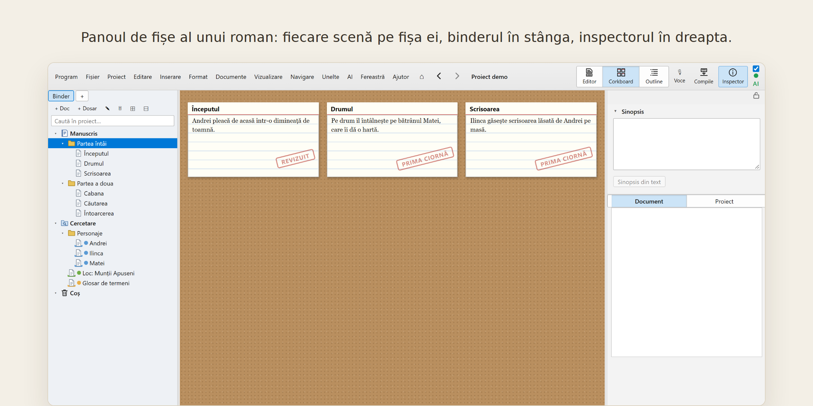
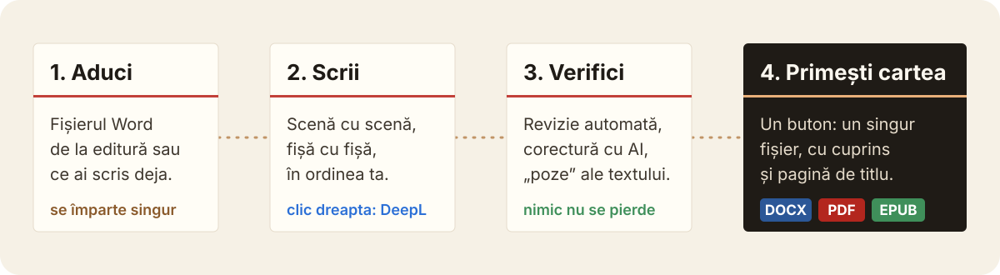

# Pneuma Sofer

Pneuma Sofer este un editor desktop pentru cărți, traduceri, teze și alte manuscrise lungi. Proiectul organizează textul în documente și dosare, păstrează manuscrisul pe calculatorul utilizatorului și oferă instrumente pentru scriere, revizie, cercetare, import, export și compilare.

**[Descarcă ultima versiune pentru Windows](https://github.com/Hermeneuticus-of-things/Scriptorium/releases/latest)**

AI-ul și serviciile online sunt opționale. Scrierea, organizarea, salvarea, revizia deterministă, backupul și exportul de bază funcționează fără ele.

<p align="center">
  
</p>

## Ce este Pneuma Sofer

Un manuscris lung este mai ușor de controlat când fiecare scenă, capitol, notă sau sursă poate fi deschis separat. Pneuma Sofer combină un binder pentru structură, un editor pentru text și panouri de lucru pentru metadate, cercetare, revizie și compilare.

Aplicația este local-first: proiectele sunt foldere cu fișiere locale, fără cont obligatoriu și fără ca textul să fie trimis automat în afara calculatorului. Serviciile externe sunt folosite numai când utilizatorul le configurează și le pornește.

## Funcții principale

| Zonă | Ce oferă |
|---|---|
| Scriere | documente și dosare, scene, capitole, rezumate, ținte și organizare vizuală |
| Binder și navigare | arbore de proiect, căutare rapidă, colecții, filtrare și mutarea documentelor |
| Editor | formatare, note, comentarii, legături interne, imagini și selecție de text |
| Revizie | verificări locale pentru tipografie, spații, ghilimele, punctuație și repetiții |
| Reparații simple | operații deterministe cu previzualizare și aplicare explicită, fără AI și fără Inspector |
| AI | fereastră separată, mare și independentă de Inspector, cu rezultate care pot fi acceptate sau respinse |
| Cercetare | surse locale, pagini web salvate, PDF-uri, note și întrebări opționale asistate de AI |
| Traducere și dicționare | integrări configurabile pentru traducere, sinonime și dicționare online |
| Dictare | transcriere locală, inserare la cursor sau înlocuirea selecției |
| Compile și export | DOCX, PDF, EPUB, HTML, Markdown, RTF, ODT, LaTeX, Fountain, Final Draft și text simplu |
| Proiecte Scrivener | import și export pentru proiecte `.scriv`, cu raportarea elementelor convertite și a celor păstrate |
| Siguranță | salvare, snapshot-uri, backup incremental și operații lungi cu progres și anulare unde sunt disponibile |

## Cum se lucrează

1. Creezi un proiect sau imporți un manuscris existent.
2. Organizezi conținutul în dosare, capitole și scene.
3. Scrii și editezi în documentul activ, păstrând cercetarea și notele lângă text.
4. Rulezi verificări locale sau deschizi separat suprafața AI când ai nevoie de ea.
5. Examinezi rezultatul, apoi aplici explicit modificările acceptate.
6. Compilezi sau exporți proiectul în formatul necesar.

Operațiile importante sunt gândite cu fluxuri de tip **previzualizare → aplicare** sau **propunere → acceptare/respingere**, astfel încât schimbările să nu fie făcute implicit peste textul autorului.

<p align="center">
  
</p>

## AI și reparații locale

AI-ul este o suprafață de lucru distinctă. Fereastra AI nu este Inspectorul și nu depinde de Inspector pentru a funcționa. Rezultatele AI sunt afișate separat, cu context și acțiuni explicite pentru acceptare, respingere sau anulare.

Reparațiile locale și deterministe sunt disponibile în **Reparații simple**. Acestea nu folosesc AI, nu trimit text către servicii externe și nu sunt ascunse în fereastra AI. Înainte de aplicare, utilizatorul poate vedea ce se va schimba.

Când sunt configurate, pot fi folosite modele sau servicii precum Anthropic, OpenAI, Google Gemini, OpenRouter, NVIDIA NIM, Mistral, Groq, DeepSeek, xAI, Ollama și LM Studio. Cheile sunt gestionate local de aplicație și nu sunt incluse în proiectele publicate.

## Manuscrise mari și operații lungi

Aplicația folosește încărcare leneșă și actualizări limitate ale suprafețelor vizibile pentru a evita încărcarea întregului manuscris în interfață. Importul, exportul, compilarea și backupul pot afișa progresul operației; operațiile care durează mai mult nu ar trebui să ascundă starea curentă a lucrului.

Pentru proiecte mari, recomandarea este să păstrezi backupurile în afara folderului de lucru și să verifici rezultatul după import sau export înainte de a șterge sursa. Testele de performanță și problemele cunoscute sunt urmărite în [ROADMAP.md](ROADMAP.md) și în documentația tehnică din [docs](docs/).

## Import, export și proiecte Scrivener

Pneuma Sofer poate importa, în funcție de format și de conținut, DOCX, RTF, ODT, HTML, Markdown, Fountain, Final Draft, OPML, pagini web, BibTeX/CSL-JSON și proiecte `.scriv`.

Exportul și Compile pot produce DOCX, PDF, EPUB, HTML, RTF, ODT, Markdown, MultiMarkdown, text, LaTeX, Fountain, Final Draft și proiecte `.scriv`. La operațiile de conversie, aplicația separă elementele convertite, elementele păstrate în copia originală și elementele care nu pot fi convertite integral.

Formatele de Compile pot include manuscrisul complet, un dosar, selecția curentă sau o colecție. Sunt disponibile setări pentru secțiuni, titluri, separatoare, note, comentarii, metadate, pagină, antet, subsol, copertă și cuprins.

## Salvare, snapshot-uri și backup

Proiectele sunt păstrate local într-un folder cu fișiere text și resurse asociate. Înaintea schimbărilor importante poți crea un snapshot și poți compara versiuni ale documentelor. Backupul incremental este destinat protejării lucrului fără a încărca interfața cu operații inutile.

Structura tipică a unui proiect este:

```text
Cartea mea.scribner/
  project.json           structura, metadate și setări
  docs/<id>.html         textul documentelor
  notes/<id>.html        notele
  snapshots/<id>/        versiuni salvate
  media/                 imagini, PDF-uri și audio
```

Nu include manuscrise, corpusuri personale, chei API sau alte date private în issue-uri, pull request-uri, builduri publice ori release-uri.

## Actualizări ale aplicației

Versiunea instalată citește informațiile actuale din pagina GitHub Releases a proiectului. Updaterul compară versiunea locală cu release-ul disponibil, alege installerul sau varianta portabilă potrivită și verifică fișierul descărcat înainte de folosire.

Verificarea include conexiuni HTTPS către hosturi permise, dimensiunea așteptată și SHA-256 publicat pentru asset. Cererile repetate folosesc ETag atunci când este disponibil. Installerul și varianta portabilă rămân variante distincte, iar istoricul release-urilor GitHub nu este rescris pentru a elimina versiuni anterioare.

Pentru a vedea ce este disponibil acum, folosește linkul Releases de la începutul acestui document. README-ul nu duplică numărul unei versiuni, pentru ca documentația să nu devină învechită la următoarea publicare.

## Instalare și dezvoltare

Din pagina Releases alegi installerul Windows sau varianta portabilă. Installerul se instalează pentru utilizatorul curent; dezinstalarea aplicației nu șterge proiectele tale.

Pentru dezvoltare locală ai nevoie de Node.js și git:

```bash
git clone https://github.com/Hermeneuticus-of-things/Scriptorium.git
cd Scriptorium
npm ci
npm start
```

Comenzi utile:

```bash
npm test
npm run test:e2e
npm run build
npm run dist:win
npm run dist:win:setup
```

Pentru buildul installerului Windows este necesar și Inno Setup. Artefactele de build se păstrează în directorul `release/` și nu trebuie adăugate în commiturile sursă dacă sunt deja gestionate prin GitHub Releases.

## Arhitectură și documentație

Aplicația este construită cu Electron, React, Vite și Tiptap/ProseMirror. Codul pentru procesul principal, renderer, import/export, updater și testele E2E este separat pentru a permite verificarea fiecărei suprafețe.

Documentația utilă:

- [ROADMAP.md](ROADMAP.md) — lucrări planificate și goluri cunoscute;
- [CHANGELOG.md](CHANGELOG.md) — istoricul public al schimbărilor;
- [docs/ARCHITECTURE.md](docs/ARCHITECTURE.md) — arhitectura aplicației;
- [docs/FORMAT-PROIECT.md](docs/FORMAT-PROIECT.md) — formatul proiectului;
- [docs/IONUT_APPLICATION_DESIGN_LANGUAGE.md](docs/IONUT_APPLICATION_DESIGN_LANGUAGE.md) — principii de interfață;
- [docs/DTED.md](docs/DTED.md) — dictare și transcriere;
- [docs/MCP_ARHITECTURA.md](docs/MCP_ARHITECTURA.md) — integrarea MCP.

## Testare și contribuții

Testele unitare verifică logica locală, importul/exportul, updaterul și protecția datelor. Testele E2E pornesc aplicația Electron și verifică fluxuri reale: meniuri, ferestre, dialoguri, salvare, persistență și operații de aplicare sau respingere.

Când raportezi o problemă, descrie pașii de reproducere, rezultatul așteptat și rezultatul observat. Nu atașa manuscrisul sau alte date private. Pentru probleme legate de UI, o captură fără conținut sensibil și logurile filtrate sunt mai utile decât o copie a proiectului.

## Licență

MIT. Vezi [LICENSE](LICENSE).
