<p align="center">
  
</p>

<p align="center">
  <a href="../../releases/latest"><strong>Descarcă pentru Windows</strong></a> ·
  <a href="#3-ce-face">Ce face</a> ·
  <a href="#5-cum-lucrezi">Cum lucrezi</a> ·
  <a href="#7-cum-lucrați-împreună">Împreună</a> ·
  <a href="#8-ce-urmează">Ce urmează</a> ·
  <a href="#instalare">Instalare</a>
</p>

## 1. Ce este

Pneuma Sofer e un program gratuit de scris cărți lungi, în română și engleză. Un roman, o traducere sau o teză într-un singur fișier Word de 300 de pagini devine greu de stăpânit. Aici textul stă pe bucăți mici, câte una pentru fiecare scenă sau capitol. Le vezi, le muți și le găsești ușor. La final apeși un buton și primești cartea întreagă.

## 2. Pentru cine

Pentru oricine are de scris sau de tradus un text lung și vrea să-l stăpânească pe bucăți.

<p align="center">
  
</p>

## 3. Ce face

<p align="center">
  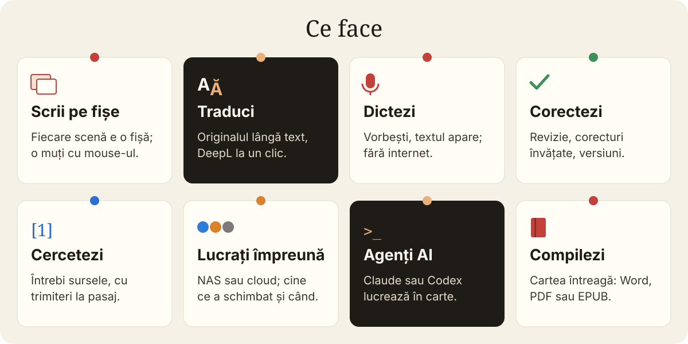
</p>

| Funcția | Pe scurt |
|---|---|
| [Scrii pe fișe](#scrii-pe-fișe) | scene și capitole pe fișe, cronologie, legături între documente |
| [Traduci](#traduci) | originalul lângă traducere; DeepL, Google Translate și dicționare la un clic |
| [Dictezi](#dictezi-dted--dictare-și-transcriere) | F9 și vorbești; textul apare la cursor sau înlocuiește selecția |
| [Corectezi](#corectezi) | revizie fără AI, corecturi învățate, asistent AI opțional, versiuni |
| [Cercetezi](#cercetezi) | întrebi sursele și primești răspuns cu trimiteri |
| [Agenți AI](#agenți-ai) | Claude sau Codex lucrează direct în carte, dacă vrei |
| [Compilezi](#compilezi) | cartea întreagă în Word, PDF, EPUB și alte formate |
| [Lucrați împreună](#7-cum-lucrați-împreună) | același proiect pe mai multe calculatoare; cine ce a schimbat și când |

## 4. Cum face

- **Pe bucăți.** Fiecare scenă, capitol, notă sau sursă e un document separat în *binder*, lista din stânga. Le aranjezi ca pe fișe; ordinea din binder e ordinea din carte.
- **Pe calculatorul tău.** Proiectul e un folder cu fișiere text simple. Nu ai nevoie de cont și nici de internet; nimic nu pleacă din calculator dacă nu vrei.
- **Fără să pierzi ceva.** Totul se salvează singur, copiile de siguranță se fac automat, iar înainte de o schimbare mare faci o „poză” a textului (snapshot), la care te poți întoarce.
- **AI doar dacă vrei.** Programul e complet fără AI. Cu o cheie pusă de tine, asistentul propune, iar tu accepți; paragrafele scrise de tine nu sunt rescrise.
- **La final, o singură carte.** *Compile* adună bucățile în formatul ales, cu pagina, titlurile și notele așezate cum hotărăști tu.

## 5. Cum lucrezi

<p align="center">
  
</p>

1. **Aduci textul.** Pornești de la zero, dintr-un șablon, sau imporți Word, RTF, ODT, Markdown, pagini web, scenarii ori un proiect `.scriv`; capitolele devin fișe singure.
2. **Scrii pe fișe.** Scrii, muți, împarți și unești scene; ții personajele, locurile și cercetarea lângă text. Dacă vrei, dictezi.
3. **Verifici.** Revizia găsește ghilimele, spații, punctuație și repetiții; compari versiunile; întrebi sursele.
4. **Primești cartea.** *Fișier → Compilează…* și ai DOCX pentru editură, PDF pentru tipar sau EPUB pentru cititor.

## 6. Funcțiile, pe rând

### Scrii pe fișe

<p align="center">
  
</p>

Fiecare scenă are fișa ei, cu un rezumat de două rânduri. O muți cu mouse-ul și textul se mută odată cu ea. Îți pui o țintă, de exemplu 1.000 de cuvinte pe zi, și vezi cât ai scris. Personajele, locurile și cercetarea stau lângă text.

<details>
<summary><strong>Cronologie, legături între documente, panoul de referință</strong></summary>

<p align="center">
  
</p>

Cronologia îți arată pe zile cine unde e, ca să prinzi contradicțiile înainte de editor. O pagină web pusă în Cercetare se salvează cu tot cu imagini, așa că o citești și fără internet. *Vizualizare → Focus lingvistic* îți colorează substantivele sau verbele, ca să vezi unde se îngroașă textul.

**Legături între documente.** Scrii `[[Matei]]` și textul devine legătură către fișa lui Matei. Dacă documentul nu există încă, de exemplu `[[Titlu nou]]`, programul îți propune să-l creeze pe loc. În Inspector, la *Legături către acest document*, vezi toate locurile care trimit la el. Pe panoul de fișe alegi și cum arată fișele: colțuri rotunjite sau drepte, liniate ca pe hârtie, colorate după etichetă.

<p align="center">
  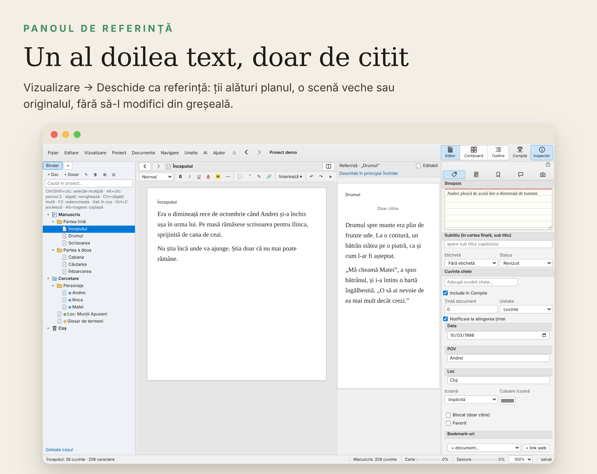
</p>

*Vizualizare → Deschide ca referință* pune alt document lângă cel la care scrii, doar de citit: planul, o scenă veche sau originalul. Bifezi *Editabil* dacă vrei totuși să-l schimbi.

</details>

### Traduci

Fără nicio configurare, traducerea merge pe endpointul public gratuit al Google (etichetat onest „Google (fără cheie)" — neoficial, fără SLA). Cu cheie Google Cloud Translation sau **conectare cu contul Google (OAuth)**, traducerea folosește API-urile oficiale: se dezvoltă din secțiunea *Setări → Servicii și conturi → Google Cloud Translation* cu butonul „Conectează cu Google" (consimțământ în browser, fără parolă stocată).

<p align="center">
  
</p>

Pui fișierul Word primit de la editură și Pneuma Sofer îl împarte pe capitole. Ții originalul într-o parte și traducerea în cealaltă; fereastra în care scrii are chenar verde, cealaltă e ușor estompată. La final trimiți înapoi un singur fișier Word, cu notele de subsol la locul lor.

<p align="center">
  
</p>

Clic dreapta pe un cuvânt și ai la îndemână:

- **Traduce:** DeepL sau Google Translate, pe cuvânt, frază sau paragraf. Cu o cheie DeepL, inclusiv cea **gratuită** (DeepL API Free, 500.000 de caractere pe lună), traducerea apare direct în program și înlocuiește selecția cu un clic.
- **Sinonime:** sinonimele se aduc direct în program și apar într-o fereastră mică; alegi cuvântul potrivit dintr-un clic, fără să pleci din text.
- **Dicționare:** dexonline, Wiktionary, Cambridge, Merriam-Webster, Linguee cu exemple traduse, IATE pentru terminologia UE.
- **Redă audio:** citire cu voce tare cu vocea românească **Mihai**, din program, fără internet — selecția, de la cursor, fraza, paragraful, tot documentul sau toată cartea. Vocea ascultă punctuația (virgulă, întrebare, exclamare, pauze între paragrafe), nu citește monoton.
- **Asistent AI, În proiect, NotebookLM:** explicație sau traducere, căutare în toată cartea, glosar, întrebări despre termen în sursele tale. Cu un notebook configurat (Setări → Chei și conturi) și serverul `notebooklm-mcp` pornit, apare și „Întreabă NotebookLM pe surse (întrebări de continuare)”: editorul interoghează notebook-ul cu întrebări de continuare până primește un răspuns pe surse.

### Dictezi: D&TED – Dictare și transcriere

<p align="center">
  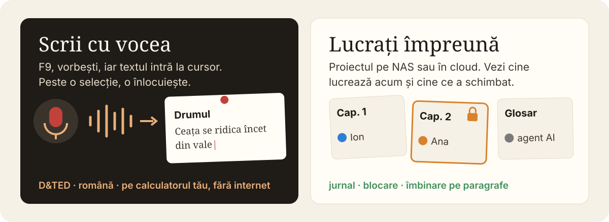
</p>

<p align="center">
  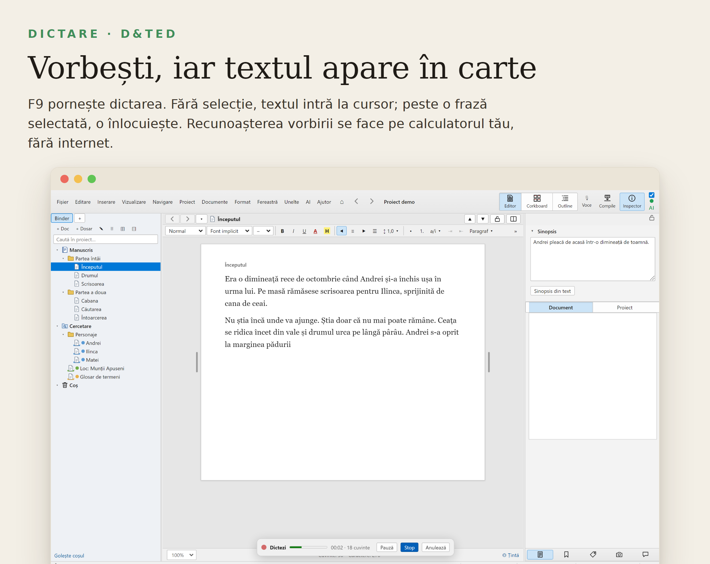
</p>

Apeși **F9** și vorbești. Textul apare cam la fiecare patru secunde, cu spații și majusculă la început de frază.

- **Text nou:** fără selecție, textul intră la cursor.
- **Modificare:** selectezi un cuvânt, o frază sau un paragraf și dictezi; ce spui înlocuiește selecția, iar un singur Ctrl+Z te întoarce la textul vechi.
- **Din click dreapta:** în editor, lângă „Redă audio", meniul **Dictare** are „Dictează de la cursor", „Dictează (înlocuiește selecția)" și „Oprește dictarea" (apare doar cât timp dictezi). Același lucru ca la F9, dar fără să iei mâna de pe text.
- **Pauză**, **Stop** și **Anulează**, care scoate tot ce ai dictat de la pornire.
- **Fișier → Importă → Transcrie fișier audio…**: un MP3, WAV, M4A, OGG sau FLAC devine document în Cercetare, pe paragrafe, cu ora din înregistrare.
- Numele din carte le scrii o dată în *Setări → Servicii și conturi*, ca să fie recunoscute corect; înlocuirile tale automate se aplică și textului dictat.

Recunoașterea vorbirii e **în Pneuma Sofer** și lucrează **pe calculatorul tău, fără internet**. Prima dată, din *Setări → Voce și traducere → Dictare și transcriere*, apeși *Descarcă motorul* (în jur de 590 MB, o singură dată; cu placă NVIDIA poți lua și varianta mai rapidă). Motorul e [whisper.cpp](https://github.com/ggml-org/whisper.cpp) cu modelul Whisper large-v3-turbo; amprenta fișierelor e verificată la descărcare. Pentru cea mai bună recunoaștere a românei, alege [D&TED](https://github.com/Hermeneuticus-of-things/dted) în locul lui: D&TED folosește modelul **eek**, antrenat pe română, cu aproape jumătate din greșeli (5,4% cuvinte greșite față de 10,9% la modelul standard). După *Verifică*, în aceeași fereastră alegi modelul și vezi care e folosit acum. Pneuma Sofer se leagă de D&TED prin modul serviciu (protocol 1) și alege singur modelul potrivit. Mai important, D&TED nu rămâne doar la română: aduce recunoaștere și pe alte limbi, iar lista crește cu fiecare versiune. O versiune de D&TED care nu vorbește acest protocol îți spune să o actualizezi.

**D&TED se actualizează din Pneuma Sofer.** Butonul *Caută actualizări D&TED…* (aceeași fereastră din Setări) arată versiunea ta și pe cea nouă de pe pagina D&TED și, la cerere, **descarcă, verifică și instalează** versiunea nouă în folderul tău de utilizator (fără drepturi de administrator). Instalarea nu se face orbește: mai întâi programul nou trebuie să răspundă la deschidere pe același protocol; dacă ceva nu merge, instalația veche rămâne pe loc, activă. Programul verifică singur, discret, la pornire și la trei zile (bifa „Caută actualizări D&TED automat") și te anunță când există versiune nouă.

<p align="center">
  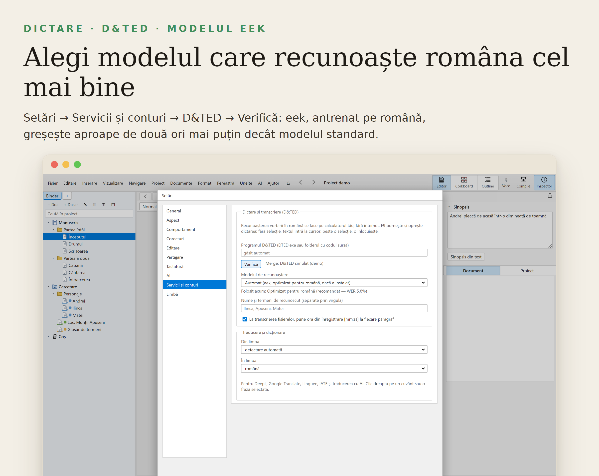
</p>

### Corectezi

<p align="center">
  
</p>

Revizia automată, fără AI, găsește ghilimelele greșite, spațiile duble, punctuația și repetițiile, apoi le repară cu un clic. Când corectezi de mână un cuvânt subliniat, programul ține minte și data viitoare îl corectează singur. Cuvintele străine și transliterările (de exemplu sanscrita în IAST: ā, ī, ṛ, ś) rămân neatinse.

<details>
<summary><strong>Repetiții apropiate, asistentul AI, versiuni</strong></summary>

<p align="center">
  
</p>

**Repetiția apropiată.** Același cuvânt în aceeași frază sau în fraza vecină apare ca semnal: `⚠ REP L1 «scutul» ×2`. Un clic te duce la el; tu hotărăști dacă supără.

**Textul tău e protejat.** Ce scrii de mână devine text al autorului. Revizia cu AI nu schimbă, nu mută și nu șterge niciun paragraf scris de tine; doar semnalează, iar modificările tale se notează.

<p align="center">
  
</p>

Asistentul AI face corectură, rezumate sau o a doua părere; vezi exact ce schimbă și accepți doar ce îți place. Merge cu Anthropic, OpenAI, Google Gemini, NVIDIA NIM, OpenRouter și alții, sau cu un model care rulează pe calculatorul tău. Îl poți opri complet din Setări.

<p align="center">
  
</p>

Înainte de o rescriere mare faci o „poză” a textului; mai târziu compari versiunile și te întorci la cea bună.

</details>

### Cercetezi

<p align="center">
  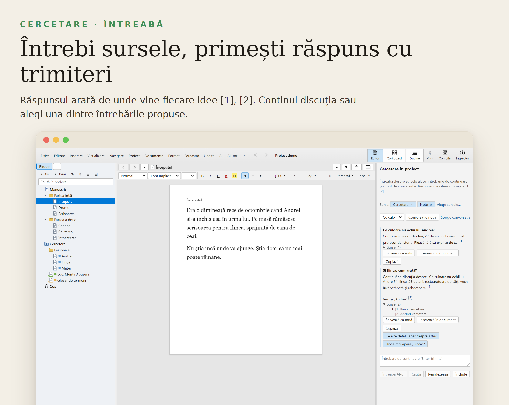
</p>

În **Cercetare → Întreabă** discuți cu sursele tale: primești răspunsul cu trimiteri [1], [2], iar un clic te duce la pasaj. Continui discuția, alegi ce surse folosește (manuscrisul, cercetarea, notele sau anumite dosare), aduci PDF, Word, text sau pagini web și salvezi răspunsul ca notă ori îl inserezi în text, cu trimiterile ca note de subsol. Fără AI, panoul doar caută în surse. Cartea se poate trimite și în **NotebookLM**, **Gemini**, **ChatGPT** sau **Manus**, gata împărțită.

### AI — tot ce ține de AI, într-un singur loc (opțional)

<p align="center">
  
</p>

Rundele **I-EDIT / I-REP** arată acum răspunsul AI **pe măsură ce se scrie** (streaming live, cronometru, anulare cu Esc) și o **estimare înainte de rulare**: „Estimare: 7 documente × 3 bucle ≈ 21 apeluri AI". Rezultatele serviciilor (gramatică, sinonime, traducere, dicționare) apar **în interiorul paginii**, într-un popover ancorat la selecție, cu mărimi care se potrivesc conținutului — nu ca fereastră peste text și fără trimitere la site-uri externe.

Tot ce folosește AI stă grupat și se pornește sau se oprește dintr-un singur loc (pastila **AI** din bară și *Setări → Chei și conturi*). Fără AI, programul merge întreg: verificarea **I-REP** și reparațiile sigure (deterministe) rămân.

- **Asistentul AI** — corectură, rezumate sau o a doua părere; vezi exact ce schimbă și accepți doar ce vrei.
- **I-EDIT** — runde editoriale pe tot textul, cu regulile tale.
- **Bucla de reparare (I-REP cu AI)** — repară problemele semnalate și reverifică.
- **În surse / NotebookLM** — întrebi sursele tale; cu un notebook configurat, chiar cu întrebări de continuare până primește răspuns.
- **Traducere și definiții** — DeepL/Google și explicații AI direct din meniul cuvântului.
- **Agenți AI prin MCP** — Claude sau Codex lucrează direct în carte (mai jos).

Dacă lucrezi cu un asistent AI ca Claude sau Codex, îl poți lăsa să lucreze direct în carte: citește capitolele, scrie rezumate, caută, face revizia. Din *AI → Conectează la Claude (MCP)* îl legi cu un clic — dialogul detectează ce clienți AI ai instalați (Claude Desktop, Claude Code, Cursor, Gemini CLI, OpenCode, Windsurf, VS Code, Codex) și scrie configurarea fiecăruia dintr-un clic, cu copie de siguranță. Agentul primește peste 80 de unelte (citire/scriere documente, binder, căutare, snapshot-uri, Compile, import/export, revizie). Înainte de fiecare modificare a lui se face o copie, iar tot ce face se notează. Nu e obligatoriu: programul merge la fel și fără.

> [!IMPORTANT]
> **O vorbă despre AI.** Oricât de bun ar fi modelul și oricât te-ar ajuta, AI-ul nu garantează originalitatea. Poate combina idei, deschide perspective și stimula creativitatea, dar se bazează pe ceea ce a învățat deja. Noutatea autentică apare din experiența, intuiția și gândirea ta, nu din simpla reformulare a unor idei existente.
>
> Mai mult, răspunsurile AI-ului sunt influențate de valorile, regulile și interesele companiilor care îl dezvoltă, inclusiv de felul în care acestea stabilesc ce poate spune și cum. Astfel, fără să-ți dai seama, poți ajunge să reproduci viziunea lor asupra lumii, crezând că este propria ta gândire.
>
> Pneuma Sofer merge întreg și fără AI: scrisul rămâne al tău, iar AI-ul îl pornești sau îl oprești oricând, dintr-un singur loc. Folosește-l ca pe un instrument de scris mai inteligent, care elimină fricțiunile și birocrația editorială, nu ca pe un înlocuitor al gândirii sau al creativității tale. Tehnologia trebuie să-ți elibereze scrisul, nu să-l scrie în locul tău.

Pentru **NotebookLM**, secțiunea *Servicii și conturi* are un buton dedicat de logare: se deschide o fereastră în care te autentifici o dată pe Google; sesiunea rămâne doar în calculatorul tău și e folosită de serverul NotebookLM la întrebările pe surse.

### Compilezi

<p align="center">
  
</p>

*Fișier → Compilează…* adună bucățile într-o singură carte. Pașii sunt mereu aceiași: alegi ce intră, alegi forma, apeși *Compilează*. Formatele gata făcute acoperă manuscrisul pentru editură, cartea tipărită 6 × 9 in, e-book-ul și PDF-ul de citit; ieșirea poate fi Word, PDF, EPUB, ODT, RTF, HTML, Markdown, LaTeX, Fountain sau Final Draft.

<details>
<summary><strong>Compile pas cu pas: conținut, formate, secțiuni, pagină, tipografie</strong></summary>

**1. Ce intră în carte.** În fila *Conținut* alegi tot manuscrisul, un singur dosar sau doar selecția curentă, ori o colecție. Orice document poate fi scos din carte fără să-l ștergi: clic dreapta în binder și debifezi *Include în Compile* (titlul apare tăiat). Poți filtra după etichetă și după stare, de exemplu doar scenele „Final”. Tot aici adaugi materia de început (pagina de titlu automată cu titlu, subtitlu și autor, cuprinsul, un dosar cu dedicație sau prefață) și materia de final.

<p align="center">
  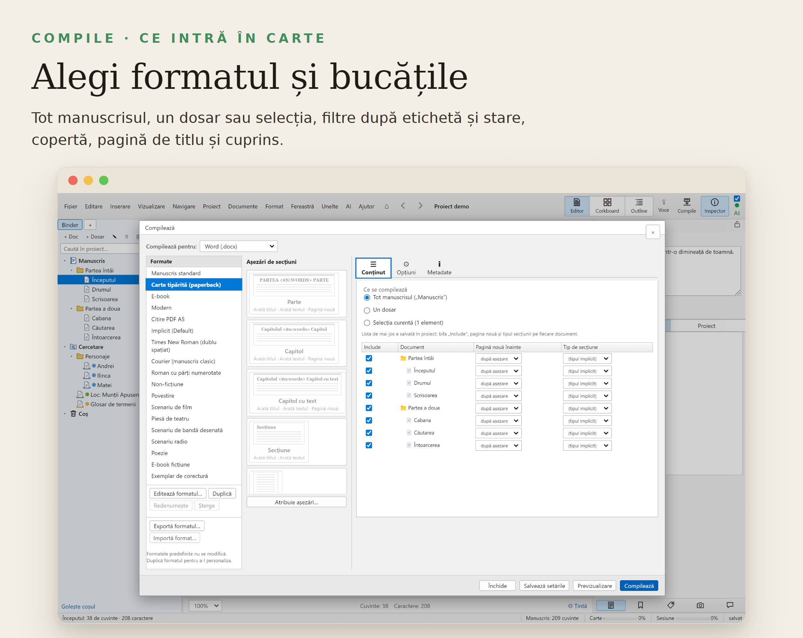
</p>

**2. Forma: formatele de Compile.** În stânga ferestrei sunt formatele gata făcute:

| Format | Pentru ce |
|---|---|
| Manuscris standard | trimis la editură: Georgia 10 pt, titluri 12 pt bold, subtitluri 10 pt bold, pagină A4, rânduri largi, antet „Nume / Titlu / pagină” |
| Carte tipărită (paperback) | carte de tipar 6 × 9 in, margini în oglindă, Garamond, capitole pe pagină nouă |
| E-book | EPUB curat, cu cuprins de navigare și copertă |
| Modern | aspect aerisit, capitole numerotate simplu |
| Citire PDF A5 | PDF comod de citit pe ecran sau de tipărit acasă |
| Implicit (Default) | punct de plecare neutru |
| Times New Roman (dublu spațiat) | cerința clasică a multor concursuri și edituri |
| Courier (manuscris clasic) | manuscris în stil mașină de scris |

Formatele predefinite nu se modifică: apeși *Duplică*, redenumești copia și o potrivești cum vrei. Formatul tău se salvează în proiect sau, cu *Salvează global*, rămâne disponibil în toate proiectele.

**3. Formatul fișierului.** Același format de Compile produce oricare dintre ieșiri:

| Ieșire | Când o folosești |
|---|---|
| Word (.docx) | pentru editură și redactor; secțiuni separate, comentarii și modificări urmărite opționale |
| PDF | tipar sau citire; aceeași pagină ca la tipărire |
| EPUB | e-book pentru Kobo, Apple Books, PocketBook, Calibre |
| OpenDocument (.odt), RTF | LibreOffice și alte procesoare de text |
| HTML | o pagină web cu toată cartea |
| Markdown, MultiMarkdown, LaTeX | lucru tehnic, Pandoc, tipografie LaTeX |
| Fountain, Final Draft (.fdx) | scenarii |
| Text simplu | orice altceva |

*Tipărire / previzualizare* îți arată paginile înainte de orice. Proiectul întreg se poate exporta și ca `.scriv`, din meniul *Fișier*.

**4. Tipurile de secțiune.** Fiecare bucată din binder are un tip: *Parte*, *Capitol*, *Secțiune*, *Scenă*, *Pagină de titlu*. Implicit, dosarele sunt capitole, documentele cu subdocumente sunt „capitol cu text”, iar documentele simple sunt scene; poți schimba tipul oricărei bucăți din Inspector. În fila *Secțiuni* hotărăști pentru fiecare tip cum apare: cu titlu sau fără, cu un prefix ca „Capitolul <$n>” sau „Partea <$n:Words>” („Partea Unu”), cu majuscule, aliniat la centru sau la stânga, pe pagină nouă sau nu, cu text sau doar cu titlu. Scenele, de obicei, apar fără titlu, despărțite de un separator.

<p align="center">
  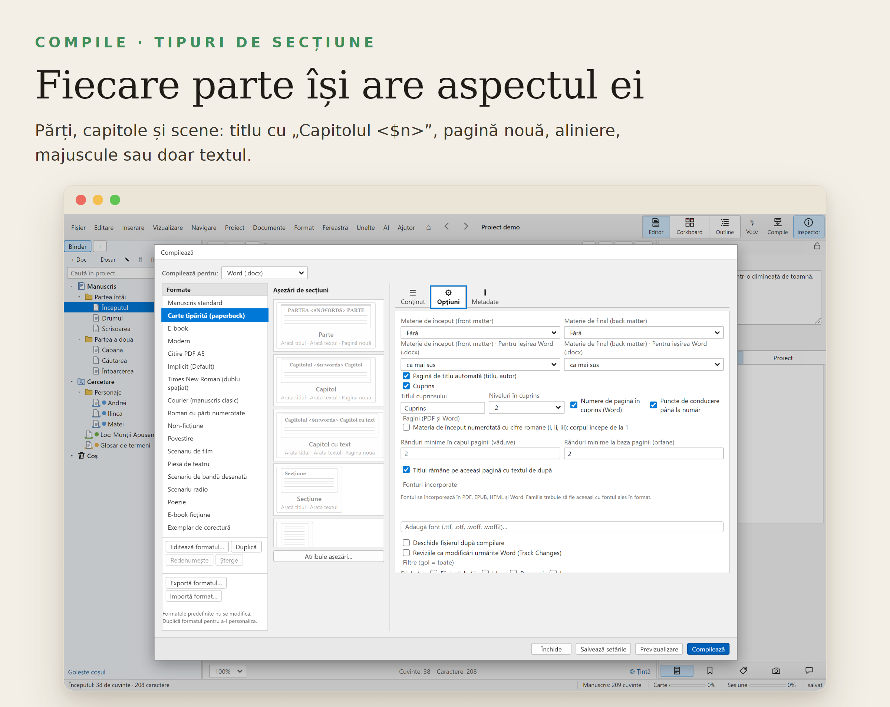
</p>

**5. Separatoare și înlocuiri.** În *Separatoare* alegi ce se pune între scene (rând gol, „#”, „* * *”) și între bucăți de tipuri diferite. În *Înlocuiri* schimbi la Compile un text cu altul, cu sau fără majuscule, cuvânt întreg sau expresie regulată; textul tău din proiect rămâne neatins. Tab-ul **Înlocuiri** de la nivel de proiect ține o listă separată, comună tuturor formatelor, aplicată înaintea celor pe format — cu ordine, bifă activ/inactiv și editare chiar și pentru formatele integrate.

### Cauți oriunde, dintr-o lovitură

**Ctrl+O** deschide *Căutarea rapidă*: batzi câteva litere și apar instant rezultate pe **Titluri**, **Sinopse** și **Text**, cu bucata de context; Enter deschide documentul, Shift îl deschide în panou de referință, Alt în cealaltă jumătate de editor, iar „Căutare completă în proiect" te duce în căutarea avansată cu interogarea precompletată.

Căutarea avansată înțelege **operatorii** „începe cu cuvântul" / „se termină cu", **inversarea rezultatelor** (ce NU se potrivește), **sortarea** (binder, titlu A-Z/Z-A, dată), **termenii speciali** („frază exactă", -excludere, wildcard cu *), **sintaxa de date** (`mdate:2026-05`, `cdate:<2y`), filtrul Draft / selecție / Included-Excluded, și ține rezultatele într-o **colecție vie** („Rezultatele căutării") care se actualizează la fiecare deschidere. *Înlocuire* are, pe lângă format, și metadatele personalizate, snapshot-uri („Include snapshot-urile") și schimbă titlurile.

**Căutare după formatare** (Ctrl+Alt+F) găsește text după îngrășăminte de caracter, linkuri, imagini sau text păstrat (preserve), iar corkboard-ul și outline-ul au **bare de filtrare** (Ctrl+F în vederea lor) care restrâng fișele la ce cauți. Uneltele adaugă **Focalizarea pe dialoguri**: toate replicile din proiect, într-un singur panou, pentru corectură.

**6. Note și comentarii.** Notele de subsol rămân note de subsol sau devin note la finalul fiecărui capitol ori al cărții. Comentariile devin comentarii Word (în DOCX) sau dispar. Adnotările din text nu ajung în carte, iar evidențierile și culorile se pot elimina. Numerotarea notelor o alegi: 1, 2, 3 · i, ii, iii · a, b, c sau simboluri (*, †, ‡, §), cu reluare de la 1 în fiecare capitol, dacă vrei.

**7. Pagina de tipar.** În fila *Pagină* alegi dimensiunea (A4, A5, Letter, 6 × 9 in sau personalizată), marginile sus, jos, interior și exterior, cu *margini în oglindă* pentru pagini față-verso. Antetul și subsolul au câte trei câmpuri (stânga, centru, dreapta), cu substituenți: titlul capitolului curent în antet, numărul paginii în subsol. Prima pagină a fiecărui capitol și paginile de la început (copertă, titlu, cuprins) rămân fără antet, iar numerotarea pornește de la textul cărții. Tot aici alegi fontul textului și al titlurilor, mărimea, spațierea și alineatul.

<p align="center">
  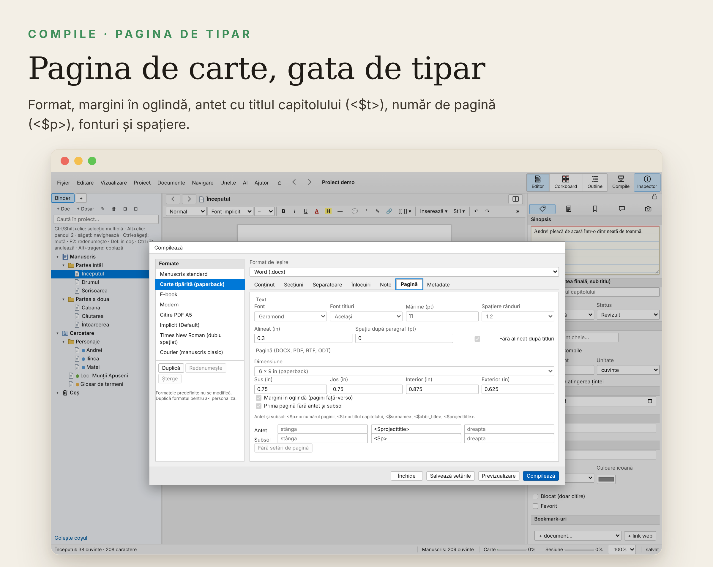
</p>

| Substituent | Devine |
|---|---|
| `<$n>`, `<$n:roman>`, `<$n:words>`, `<$n:Words>` | numărul capitolului: 3, III, trei, Trei |
| `<$t>` | titlul secțiunii; în antet, titlul capitolului curent |
| `<$p>` | numărul paginii (în antet și subsol) |
| `<$projecttitle>`, `<$abbr_title>`, `<$subtitle>` | titlul cărții, titlul scurt, subtitlul |
| `<$author>`, `<$surname>`, `<$forename>` | autorul, numele, prenumele |
| `<$wc>` | numărul de cuvinte |
| `<$date>`, `<$year>` | data și anul compilării |
| `<$img:Nume>` | imaginea cu acel nume din Cercetare |

**8. Tipografie.** La cerere, ghilimelele drepte devin „…”, două cratime devin linie de dialog, iar legăturile interne devin text simplu. În PDF și în cartea tipărită textul se desparte în silabe și nu rămân rânduri singure la început sau la final de pagină. Imaginile își păstrează mărimea din text, dar nu ies niciodată din pagină. Un pasaj marcat cu *Format → Păstrează formatarea* (o poezie, un tabel, un citat așezat anume) trece prin Compile exact cum l-ai așezat, fără fontul și spațierea formatului.

**9. Metadate și copertă.** În *Metadate* pui titlul, subtitlul, autorul, editura și limba. Coperta e o imagine din proiect; ajunge pe prima pagină în PDF și DOCX și drept copertă în EPUB.

**10. Verificarea.** *Previzualizare* îți arată rezultatul înainte să salvezi. Fișierele ies valide: DOCX-ul se deschide fără reparații în Word și LibreOffice, EPUB-ul trece verificarea cititoarelor de e-book. *Salvează setările* ține alegerile pentru data viitoare, ca următorul Compile să fie un singur clic.

**Câteva pagini pe hârtie.**

<p align="center">
  
</p>

Vrei doar câteva pagini tipărite, fără toată cartea? *Fișier → Tipărire → Configurare pagină* alege formatul, marginile, antetul și subsolul. În aplicația desktop, *Previzualizare tipărire* îți arată paginile reale (zoom, Tipărește, Salvează PDF) înainte să le trimiți la imprimantă.
</details>

### Interfața

<p align="center">
  
</p>

Sus vezi doar ce folosești des; restul stă în meniuri ordonate. Din *Vizualizare → Personalizează bara de instrumente* alegi singur butoanele și le muți cu mouse-ul. Tot ce ține de AI stă într-un singur meniu. Rigla (Ctrl+Alt+Shift+R) arată indentările și tab-urile, ca în Word.

<details>
<summary><strong>Meniul AI și rigla</strong></summary>

<p align="center">
  
</p>

Meniul AI adună asistentul, revizia, AI pe selecție sau pe toată cartea, NotebookLM și setările. Dacă oprești AI-ul, în meniu rămân doar revizia fără AI și setările.

<p align="center">
  
</p>

Tragi de marcaje ca în Word. Un clic pe riglă pune un tab: la stânga, centrat, la dreapta sau zecimal, pentru cifre aliniate la virgulă. În Word iese exact la fel.

</details>

## 7. Cum lucrați împreună

<p align="center">
  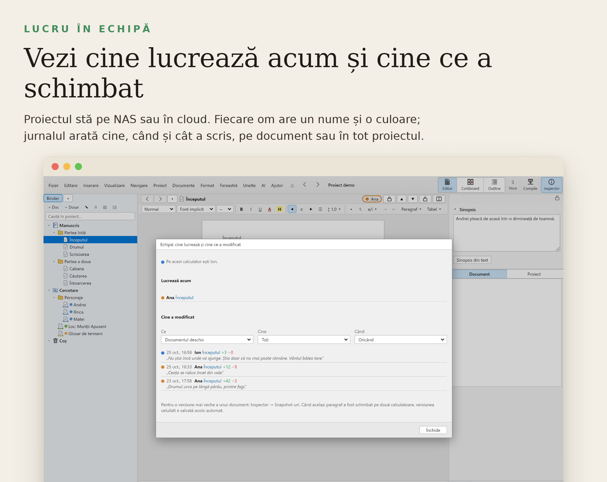
</p>

**Același proiect, pe mai multe calculatoare.** Pui folderul proiectului în OneDrive, Dropbox, Google Drive sau pe un NAS. Pe fiecare calculator îl deschizi din aplicație sau direct în Chrome ori Edge, fără instalare. Ce scrie unul apare la celălalt în câteva secunde.

**Mai mulți oameni, aceeași carte.** Fiecare își scrie numele și alege o culoare în *Setări → Partajare → Echipă*. Fără nume, proiectul rămâne exact ca până acum.

- **Cine lucrează acum:** lângă titlul documentului apare numele celui care îl are deschis; în bara de jos vezi câți sunteți.
- **Cine ce a schimbat și când:** *Proiect → Echipă…* arată jurnalul cu persoana, data, cuvintele adăugate și șterse și un fragment, filtrat pe document, persoană și perioadă.
- **Blocare:** lacătul de lângă titlu blochează documentul pentru ceilalți; la ei se deschide doar pentru citire. Un calculator închis își pierde singur blocările după o jumătate de oră.
- **Îmbinare:** schimbările făcute în paragrafe diferite se unesc singure. Același paragraf schimbat în două locuri: în bara de jos apare „Conflict”; un clic deschide fereastra cu cele două variante alături, unde alegi, pentru fiecare loc, varianta ta, a celuilalt sau pe amândouă. Varianta celuilalt rămâne oricum ca snapshot. Nu se pierde nimic.
<p align="center">
  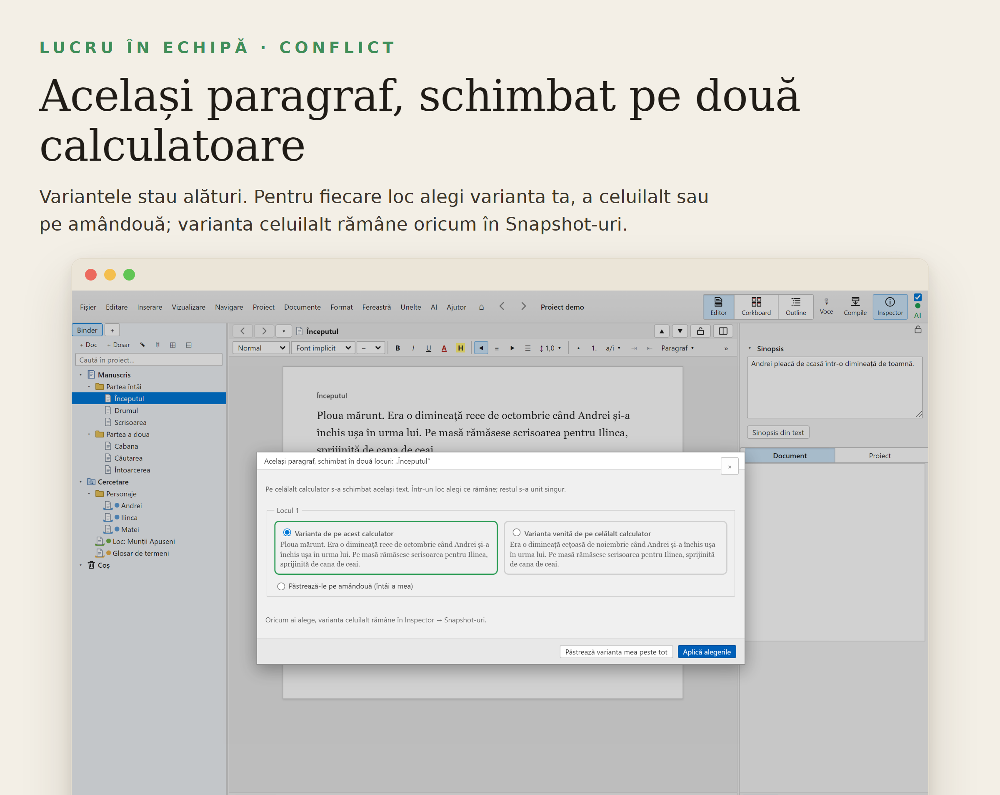
</p>

- **Fără conexiune:** dacă NAS-ul sau cloud-ul dispare, scrii mai departe. În bara de jos apare „În așteptare: 2 documente”, iar textul se trimite singur când revine folderul, chiar dacă între timp ai închis programul. Starea normală e „Sincronizat”.
- **Siguranță:** copiile de conflict făcute de OneDrive sau Dropbox sunt recunoscute și semnalate; dacă NAS-ul ori cloud-ul se deconectează, primești un mesaj și programul reia singur.
- **Agenții AI** (Claude, Codex prin MCP) apar în jurnal ca persoană separată, „agent”, și nu scriu în documentele blocate.

<p align="center">
  
</p>

## 8. Ce urmează

Tot ce e descris mai sus e gata. Planul pentru versiunile următoare:

- **Scris în același timp în același document**, printr-un server Pneuma Sofer pe un calculator din rețea, pe NAS sau pe internet, cu cursorul și selecția celorlalți, colorate.
- **Roluri:** autor, traducător, redactor (care doar comentează și propune) și cititor; **modificări propuse**, marcate până le accepți.
- **Compararea versiunilor direct din jurnalul echipei.**
- **Adnotări pe PDF-urile** din Cercetare.
- **Golurile din auditul de paritate cu Scrivener 3**: manualul oficial (capitolele 1–26) a fost comparat capitol cu capitol cu Pneuma Sofer; diferențele sunt prioritize în [`docs/PARITY-AUDIT-NEXT-CHAPTERS.md`](docs/PARITY-AUDIT-NEXT-CHAPTERS.md) (5 goluri P1: Snapshots Manager, selectarea textului după stil, cuprinsul cu numere de pagină, lista de conținut din Compile, printarea fișelor și a outline-ului).

Planul complet, cu detaliile tehnice, e în [`ROADMAP.md`](ROADMAP.md); dictarea e descrisă în [`docs/DTED.md`](docs/DTED.md).

## 9. Instalare, întrebări, probleme

### Instalare

Din pagina [Releases](../../releases/latest) descarci una dintre variante:

- **`PneumaSofer-Setup-<versiune>.exe`** e programul de instalare, cu wizard în română. Alegi folderul, primești scurtătură pe Desktop și în meniul Start, iar la final programul pornește. Nu cere drepturi de administrator; programul se pune în `AppData\Local\Programs\Pneuma Sofer`. La dezinstalare, cărțile tale rămân.
- **`PneumaSofer-<versiune>-portabil.exe`** merge fără instalare, de oriunde, chiar de pe stick.

**Sau dintr-o singură comandă,** dacă folosești PowerShell:

```powershell
irm https://raw.githubusercontent.com/Hermeneuticus-of-things/Scriptorium/main/install.ps1 | iex
```

<details>
<summary><strong>Variante pentru cine folosește PowerShell</strong></summary>

Comanda ia ultima versiune din Releases, verifică amprenta SHA-256 publicată de GitHub și pornește installerul. Variante, puse înainte, pe același rând:

```powershell
$env:SCRIBNER_PATH='1'; irm https://raw.githubusercontent.com/Hermeneuticus-of-things/Scriptorium/main/install.ps1 | iex      # și comanda pneuma în terminal
$env:SCRIBNER_SILENT='1'; irm https://raw.githubusercontent.com/Hermeneuticus-of-things/Scriptorium/main/install.ps1 | iex    # fără ferestre
$env:SCRIBNER_PORTABLE='1'; irm https://raw.githubusercontent.com/Hermeneuticus-of-things/Scriptorium/main/install.ps1 | iex  # varianta portabilă, pe Desktop
```

Poți citi scriptul înainte: [`install.ps1`](install.ps1).

Cât timp depozitul e privat, GitHub cere autentificare și pentru script, și pentru installer. Pui întâi un token personal cu drept de citire (GitHub → Settings → Developer settings → Fine-grained tokens, acces „Contents: Read” la acest depozit):

```powershell
$env:GITHUB_TOKEN='token-ul-tău'; irm -Headers @{Authorization="Bearer $env:GITHUB_TOKEN"} https://raw.githubusercontent.com/Hermeneuticus-of-things/Scriptorium/main/install.ps1 | iex
```

</details>

Programul de instalare are tot într-un singur fișier: aplicația, ajutorul, serverul MCP pentru agenți AI și comanda `pneuma` (o bifezi dacă o vrei în PATH). Nu mai descarci nimic separat.

Pentru dictare, motorul de recunoaștere a vorbirii se descarcă din program, la prima folosire (în jur de 590 MB, o singură dată); nu e inclus în installer, ca acesta să rămână mic.

O versiune nouă apare în Releases de fiecare dată când iese, automat.

La prima pornire, deschide **Tutorialul interactiv** din ecranul de start: 15 lecții scurte, în care înveți lucrând. Manualul complet se deschide oricând cu F1.


### Actualizări

Programul își caută singur versiunile noi pe pagina de versiuni a proiectului de pe GitHub: o dată pe zi (la 10 secunde după pornire, dacă ultima verificare are peste 24 de ore, și apoi la fiecare 24 de ore cât timp rămâne deschis). Când apare o versiune nouă, jos se arată o singură dată un anunț discret „Versiune nouă x.y.z — Actualizează”. Verificarea automată se oprește din Setări → General („Verifică automat actualizările”).

Oricând: **Ajutor → Caută actualizări…** (sau din paleta de comenzi; se poate pune și un buton „Actualizare” în bara de sus). Fereastra arată versiunea ta și pe cea nouă, ce aduce, apoi **Descarcă și instalează** (cu progres) și **Instalează și repornește**: lucrul se salvează, instalatorul rulează fără întrebări, închide programul și îl pornește din nou. Varianta portabilă descarcă fișierul nou și deschide dosarul în care se află; îl pornești în locul celui vechi.

Siguranță: doar prin https, doar către adresele GitHub; fișierul descărcat se verifică după dimensiune și după amprenta SHA-256 publicată (fișierul `SHA256SUMS` al fiecărei versiuni), altfel nu este folosit. Cererile repetate sunt condiționate (ETag), iar la limita de cereri GitHub programul așteaptă și reîncearcă mai târziu.

Cât timp depozitul programului e privat, actualizatorul are nevoie de un token GitHub cu drept de citire ca să vadă versiunile. Îl pui o dată în *Setări → Servicii și conturi → GitHub (actualizări)*, unde se păstrează criptat ca celelalte chei, sau, dacă preferi, ca variabilă de mediu `SCRIBNER_GITHUB_TOKEN`. Pe un depozit public nu e nevoie de token.

### Întrebări

**Am nevoie de internet?** Nu. Pneuma Sofer merge pe calculatorul tău și textele rămân la tine. Internetul îți trebuie doar pentru DeepL, dicționarele online și AI.

**Pot aduce ce am scris deja?** Da: Word, RTF, ODT, Markdown, pagini web, scenarii Fountain sau Final Draft și proiecte `.scriv`.

**Trebuie să folosesc AI?** Nu. Programul e complet fără el.

**Pot folosi DeepL, LanguageTool sau Speechify cu contul meu?** Da. Toate cheile și conturile stau într-un singur loc, în *Setări → Chei și conturi*: cheia AI (Anthropic, OpenAI, Gemini, NVIDIA NIM, OpenRouter, DeepSeek și alții; unele au și modele gratuite) și cheile serviciilor — traduci în program cu DeepL sau Google, verifici gramatica cu LanguageTool, asculți textul cu vocile Speechify, aduci bibliografia din Zotero. La fiecare se păstrează doar ce face integrarea să meargă (cheia API, uneori un ID), fără câmpuri de email și parolă care n-ajută la nimic; un link *Ce este?* îți arată ce face serviciul și *Unde găsesc cheia* te duce la pagina cheii, iar **Testează conexiunea** verifică pe loc. Orice alt cont îl ții la *Alte conturi*. Totul se păstrează criptat pe calculatorul tău.

**Pot lucra și din browser sau de pe alt calculator?** Da. Pune proiectul într-un folder OneDrive, Dropbox, Google Drive sau pe un NAS și deschide-l în Chrome sau Edge. Vezi [Cum lucrați împreună](#7-cum-lucrați-împreună).

**Pot dicta?** Da, cu F9. Motorul de recunoaștere se descarcă o dată, din Setări, apoi merge fără internet. Vezi [Dictezi](#dictezi-dted--dictare-și-transcriere).

**Pot lega un agent AI, ca Claude sau Codex?** Da, prin *AI → Conectează la Claude (MCP)*, fără Node.js. Pentru Codex, Gemini CLI, Cursor sau VS Code, comenzile sunt în *Ajutor → „Ce faci tu”*.

**În ce limbă e?** Română sau engleză, la alegere.

**Cât costă?** Nimic. E gratuit și cu cod deschis.


### Ai găsit o problemă?

<p align="center">
  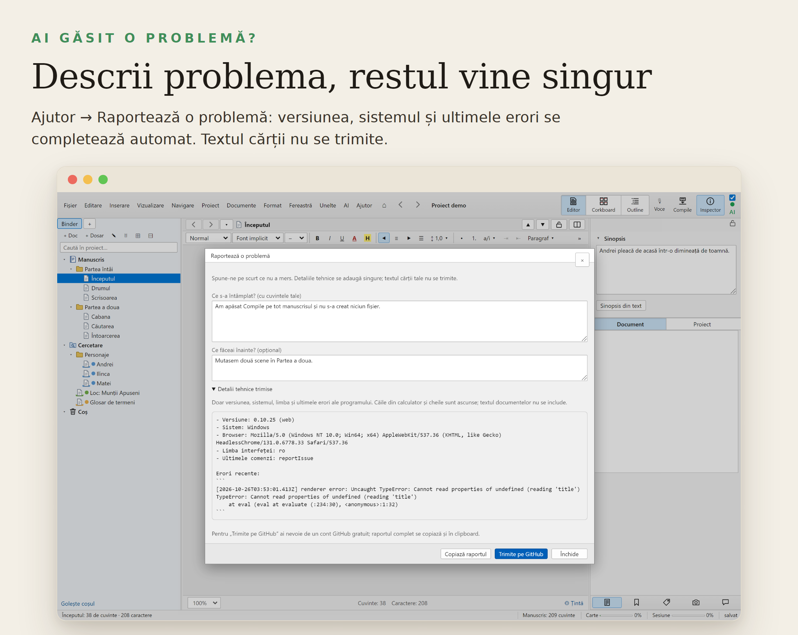
</p>

Nu trebuie să știi nimic tehnic:

1. Deschide *Ajutor → Raportează o problemă…*. Dacă programul a întâlnit o eroare, îți propune singur, discret, jos în dreapta: „A apărut o problemă. Trimite raportul?”.
2. Scrie cu cuvintele tale ce s-a întâmplat și, dacă vrei, ce făceai înainte.
3. Apasă *Trimite pe GitHub*. Se deschide pagina proiectului cu raportul completat; acolo apeși *Submit new issue*. Ai nevoie de un cont GitHub gratuit. Fără cont, apeși *Copiază raportul* și trimiți textul cum îți e comod.

**Ce se trimite:** versiunea programului, sistemul de operare, limba interfeței, ultimele erori înregistrate de program și numele ultimelor comenzi. Le vezi pe toate la *Detalii tehnice trimise*, înainte să trimiți. **Ce nu se trimite:** textul cărții și al notelor, numele tău de utilizator, căile proiectelor și cheile API; acestea sunt ascunse automat.


### Sub capotă

<details>
<summary><strong>Pentru cine vrea detalii tehnice</strong></summary>

**Agenți AI și linia de comandă.** Un agent AI poate lucra direct în proiect: citește capitolele, scrie sinopsisuri, caută, face revizia sau Compile. Din *AI → Conectează la Claude (MCP)* configurezi Claude Desktop cu un clic sau copiezi comanda pentru Claude Code; merge și cu Codex, Gemini CLI, Cursor și VS Code. Nu ai nevoie de Node.js. Înainte de fiecare modificare a agentului se face o copie, iar tot ce face se notează.

```powershell
pneuma info "D:\Carti\Drumul spre munte.scribner"
pneuma compile "D:\Carti\Drumul spre munte.scribner" --format docx -o "D:\Carti\Drumul spre munte.docx"
pneuma export-sources "D:\Carti\Drumul spre munte.scribner" -o "D:\Surse" --target notebooklm
pneuma ask "D:\Carti\Drumul spre munte.scribner" "Ce culoare au ochii lui Andrei?" --session drum
```

<p align="center">
  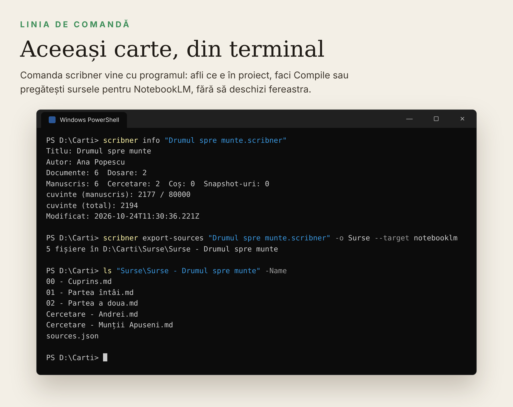
</p>

Pentru scripturi și terminal, programul instalat are comanda `pneuma` (o bifezi la instalare, fără Node.js). Toate comenzile sunt în *Ajutor → Ce faci tu → Linia de comandă*.

**Din cod sursă** (Node.js 22+ și git):

```bash
git clone https://github.com/Hermeneuticus-of-things/Scriptorium.git
cd Scriptorium
npm ci                   # dependințele, exact versiunile din package-lock.json
npm start                # construiește și pornește aplicația
npm run dist:win         # aplicația împachetată și varianta portabilă, în release/
npm run dist:win:setup   # installerul cu wizard (Inno Setup 6, pe Windows)
```

Pe Windows, în PowerShell, comenzile sunt aceleași (`git clone …`, `cd Scriptorium`, `npm ci`, `npm start`). Ai nevoie de Node.js 22 sau mai nou (`node -v`) și, doar pentru installer, de [Inno Setup 6](https://jrsoftware.org/isinfo.php). Dacă PowerShell refuză `npm` din cauza politicii de scripturi, folosește `npm.cmd` sau rulează o dată `Set-ExecutionPolicy -Scope CurrentUser RemoteSigned`.

Pe un Windows cu Node.js 22+ și Inno Setup 6 instalate, dublu clic pe `installer\build-windows.cmd` face tot: dependințele, aplicația, varianta portabilă și `PneumaSofer-Setup-<versiune>.exe`, apoi deschide folderul `release`.

`npm run dev` deschide interfața în browser; cu `?demo` la finalul adresei pornește proiectul demonstrativ din capturi.

**Asistent AI.** Furnizori: Anthropic, OpenAI, Google Gemini, OpenRouter, NVIDIA NIM, Mistral, Groq, DeepSeek, xAI, Ollama și LM Studio local, sau orice serviciu compatibil OpenAI. Cheia e criptată de sistemul de operare și rămâne în procesul principal; interfața nu o vede. Răspunsul se scrie în timp real și se poate anula.

**Revizie.** I-REP găsește și repară problemele de tipografie și stil, apoi reverifică; I-EDIT rulează runde editoriale. Profilul „Generic” merge pe orice text; profilul „Română” aplică DOOM III și regulile P1–P13 / R0–R11. Repetiția apropiată (S70, runda R8b) e semnal, nu problemă; poarta `fraza_autor_atinsa` respinge orice propunere care atinge un paragraf al autorului. Definițiile sunt în [`docs/VKB2.md`](docs/VKB2.md).

**NotebookLM.** „Exportă pentru NotebookLM” pregătește cartea ca surse: un fișier pe capitol, cercetarea și notele separat, cuprins cu rezumate.

**Interogare NotebookLM (întrebări de continuare).** Opțional: dacă pui un notebook în Setări → Chei și conturi și ai serverul `notebooklm-mcp` configurat în Claude, editorul poate deschide notebook-ul și întreba sursele cu întrebări de continuare până primește un răspuns, apoi îl folosește pentru o verificare (de pildă doctrină vs ornament, sau consistența cu sursele). Nu ține chei: autentificarea la NotebookLM e gestionată de serverul `notebooklm-mcp` prin sesiunea lui de browser (cookies) — Pneuma Sofer doar pornește acel server și îi cere răspunsuri. Fără notebook configurat, funcția e oprită și restul programului merge neschimbat.

**Agenți AI prin MCP.** `mcp/server.mjs` dă oricărui client MCP acces la un proiect: citire și scriere, căutare, metadate, note, I-REP, snapshot-uri, Compile. Înainte de fiecare scriere face o copie, notează totul în `agent-log.jsonl` și nu calcă peste salvările aplicației. `--read-only` permite doar citirea. Tot ce face programul fără ferestre e disponibil și agentului: proiecte noi din șabloane, import (DOCX, RTF, ODT, HTML, Markdown, Fountain, FDX, OPML, pagini web, `.scriv`, bibliografie) și export (Compile în toate formatele, documente, `.scriv`, NotebookLM, pachetul PENTRU EDITOR, pachet web), note pe taburi, cuvinte cheie, etichete, statusuri, metadate, tipuri de secțiune, ținte, colecții, comentarii, note de subsol, împărțire, unire, duplicare, coș, comparare de snapshot-uri, statistici, cronologie, cercetare în proiect, glosar, căutări în dicționare, backup și I-EDIT fără AI.

Programul instalat pornește serverul fără Node.js. Comanda generală e aceeași pe orice calculator (Windows) și nu numește nicio carte: agentul vede proiectele din lista recentă din Pneuma Sofer.

```bat
claude mcp add pneuma --scope user -- cmd /c %LOCALAPPDATA%\Programs\Pneuma Sofer\pneuma-mcp.cmd
```

Pentru orice alt client cu configurare JSON (Claude Desktop, Cursor, Windsurf, LM Studio, Gemini; la VS Code cheia e `servers`):

```json
"pneuma": { "command": "cmd", "args": ["/c", "%LOCALAPPDATA%\\Programs\\Pneuma Sofer\\pneuma-mcp.cmd"] }
```

`--read-only` la sfârșit permite doar citirea; `--project "<folder>.scribner"` limitează agentul la un singur proiect.

**Ce primește clientul AI.** Unelte (peste 80, fiecare marcată „doar citire” sau „modifică”), resurse (`scribner://projects`, `scribner://binder`, `scribner://doc/<id>`, `scribner://ghid`) și șabloane de lucru (`revizie_capitol`, `rezumat_proiect`, `importa_scriv`). Fiecare scriere face întâi un snapshot și e notată în `agent-log.jsonl`; documentele blocate de colegi nu se ating.

**Prin rețea** (alt calculator, server de acasă, tunel): `--http 9123` pornește serverul pe `http://127.0.0.1:9123/mcp` (Streamable HTTP). Fiecare cerere are nevoie de `Authorization: Bearer <token>` (din `--token` sau `SCRIBNER_MCP_TOKEN`; fără ele, tokenul se generează și se afișează o dată). `--host` schimbă adresa ascultată, de exemplu adresa Tailscale.

**Nume private** (`--anonymize`, oprit implicit): doar numele scrise în `<proiect>/private-names.txt` ajung la modelul AI ca jetoane (`$ENT:PERSON:…`); `+email` și `+telefon` pe câte un rând ascund și emailurile și telefoanele. Personajele și datele inventate dintr-un roman rămân vizibile; jetoanele din ce scrie agentul înapoi redevin numele reale pe calculatorul tău. Toată arhitectura: `docs/MCP_ARHITECTURA.md`.

Din cod sursă, cu Node.js:

```bash
claude mcp add pneuma -- node "/cale/Scriptorium/mcp/server.mjs" --project "/cale/Cartea mea.scribner"
```

Configurările pentru Claude Desktop, Codex, Gemini CLI, Cursor, Windsurf, LM Studio și VS Code sunt în manual, la *Ajutor → „Ce faci tu”*. Imaginile din acest README se refac cu `node scripts/readme-shots.cjs` (instrucțiunile sunt în capul scriptului).

**Formate.** Import: DOCX, RTF, ODT, HTML, Markdown, Fountain, Final Draft, OPML, pagini web, BibTeX/CSL-JSON, `.scriv`. Export și Compile: DOCX, PDF, EPUB, HTML, RTF, ODT, Markdown, MultiMarkdown, text, LaTeX, Fountain, Final Draft, `.scriv`.

**Formatul proiectului.** Un folder cu fișiere text simple, ușor de pus în git sau de sincronizat cu orice cloud. Schimbările făcute din afară se îmbină cu cele din aplicație.

```text
Cartea mea.scribner/
  project.json           structura, etichete, ținte, setări
  docs/<id>.html         textul fiecărui document
  notes/<id>.html        notele
  snapshots/<id>/*.json  „pozele” textului
  media/                 imagini, PDF, audio
```

**Teste.** `npm test` rulează peste 1.000 de teste. `npm run test:e2e` pornește aplicația reală în Electron și parcurge fluxurile principale. În CI rulează pe Linux și pe Windows, unde se construiesc și installerul și varianta portabilă; la fiecare versiune nouă, Release-ul se publică automat. Planul complet e în [`ROADMAP.md`](ROADMAP.md).

</details>


## Licență

MIT. Vezi [`LICENSE`](LICENSE).
