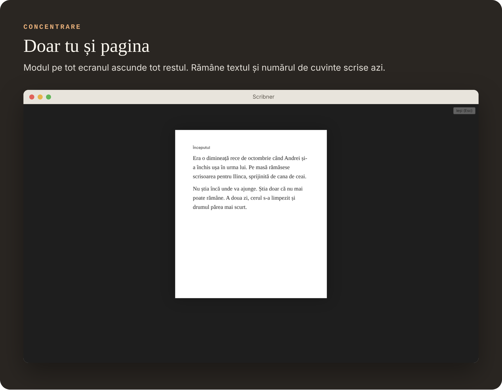

<p align="center">
  
</p>

Scrii o carte, traduci una sau lucrezi la o teză? Un singur fișier Word de 300 de pagini devine greu de stăpânit. În Scribner, textul stă pe bucăți mici, câte una pentru fiecare scenă sau capitol, pe care le vezi, le muți și le găsești ușor. Când ai terminat, apeși un buton și primești cartea întreagă, gata de trimis.

<p align="center">
  
</p>

## Traduci o carte

<p align="center">
  
</p>

- Pui fișierul Word primit de la editură și Scribner îl împarte singur pe capitole.
- Ții originalul la stânga și traducerea la dreapta, pe același ecran.
- Clic dreapta pe un cuvânt sau o frază: o trimiți la DeepL, o cauți în dexonline, Linguee sau IATE, ori ceri AI-ului o explicație. Termenul ajunge cu un clic în glosarul tău.
- Notezi termenii grei în Cercetare, ca glosar, și îi ai mereu la un clic distanță.
- La final trimiți înapoi un singur fișier Word, cu notele de subsol la locul lor.

## Scrii o carte

<p align="center">
  
</p>

- Fiecare scenă are fișa ei, cu un rezumat de două rânduri.
- Le muți cu mouse-ul până când povestea curge cum vrei.
- Îți pui o țintă, de exemplu 1.000 de cuvinte pe zi, și vezi cât ai scris.
- Înainte de o schimbare mare faci o „poză” a textului și te poți întoarce oricând la ea.

## La final, cartea întreagă

<p align="center">
  
</p>

Alegi forma (manuscris pentru editură, carte tipărită sau e-book) și Scribner adună totul într-un singur fișier: Word, PDF, EPUB și altele. Pagina de titlu, cuprinsul și numerotarea capitolelor se fac singure.

## Ce mai poate

<p align="center">
  
</p>

<p align="center">
  
</p>

<p align="center">
  
</p>

<p align="center">
  
</p>

<p align="center">
  
</p>

## Întrebări pe care le ai probabil

**Am nevoie de internet?** Nu. Scribner merge pe calculatorul tău, iar textele rămân la tine.

**Se poate pierde ceva?** Totul se salvează singur, pe măsură ce scrii. Ai și copii de siguranță automate și „poze” ale fiecărui document.

**Pot aduce ce am scris deja?** Da: Word, RTF, ODT, Markdown, pagini web și proiecte `.scriv`.

**Trebuie să folosesc inteligență artificială?** Nu. Programul e complet fără ea. Dacă vrei, o pornești din Setări cu furnizorul tău, pentru corectură, rezumate sau o a doua părere. O poți opri oricând.

**În ce limbă e?** Română sau engleză, la alegere.

## Cum îl pornești

Pe Windows ai două variante, în pagina [Releases](../../releases):

- **`Scribner-Setup.exe`**: programul de instalare, ca la orice aplicație. Alegi limba și folderul și primești scurtătură pe Desktop și în meniul Start. Se dezinstalează din Setări → Aplicații, iar textele tale rămân.
- **`Scribner-portabil.exe`**: nu se instalează. Îl pui oriunde, chiar pe stick, și îl pornești. Setările stau lângă el.

La prima pornire poți deschide **Tutorialul interactiv** din ecranul de start: 15 lecții scurte în care înveți făcând. Manualul complet e mereu la F1.

## Sub capotă

<details>
<summary><strong>Pentru cine vrea detalii tehnice</strong></summary>

**Construit din cod sursă** (ai nevoie de Node.js 22+):

```bash
npm install
npm start          # construiește și pornește aplicația
npm run dist:win         # aplicația împachetată și varianta portabilă, în release/
npm run dist:win:setup   # installerul cu wizard (Inno Setup 6, pe Windows)
```

`npm run dev` deschide interfața în browser; cu `?demo` la finalul adresei pornește un proiect demonstrativ.

**Asistent AI.** Furnizori: Anthropic, OpenAI, Google Gemini, OpenRouter, Mistral, Groq, DeepSeek, xAI, Ollama și LM Studio local, sau orice serviciu compatibil OpenAI. Cheia e criptată de sistemul de operare și rămâne în procesul principal; interfața nu o vede. Face corectură cu diferențe înainte/după, rezumate, continuare în stilul tău, critică, verificare de consistență, fișe de personaje și revizie pe niveluri. Răspunsul se scrie în timp real și se poate anula.

**Revizie fără AI.** I-REP găsește și repară problemele de tipografie și stil, apoi reverifică; I-EDIT rulează runde editoriale. Profilul „Generic” merge pe orice text; profilul „Română” aplică DOOM III și regulile P1–P13 / R0–R11.

**NotebookLM.** „Exportă pentru NotebookLM” pregătește cartea ca surse (un fișier pe capitol, cercetarea și notele separat, cuprins cu rezumate), în limitele NotebookLM.

**Agenți AI prin MCP.** Serverul `mcp/server.mjs` dă acces oricărui client MCP la un proiect: citire și scriere, binder, căutare, metadate, note, comentarii, I-REP, snapshot-uri, Compile. Fiecare scriere face snapshot înainte și se notează în `agent-log.jsonl`. `--read-only` permite doar citirea.

```bash
claude mcp add scribner -- node "/cale/Scribner/mcp/server.mjs" --project "/cale/Cartea mea.scribner"
```

**Formate.** Import: DOCX, RTF, ODT, HTML, Markdown, Fountain, Final Draft, OPML, pagini web, BibTeX/CSL-JSON, `.scriv`. Export și Compile: DOCX, PDF, EPUB, HTML, RTF, ODT, Markdown, MultiMarkdown, text, LaTeX, Fountain, Final Draft, `.scriv`.

**Formatul proiectului.** Un folder cu fișiere text simple, ușor de versionat cu git sau de sincronizat cu orice cloud:

```text
Cartea mea.scribner/
  project.json           structura, etichete, ținte, setări
  docs/<id>.html         textul fiecărui document
  notes/<id>.html        notele
  snapshots/<id>/*.json  „pozele” textului
  media/                 imagini, PDF, audio
```

**Teste.** `npm test` rulează testele bibliotecilor; `npm run test:e2e` pornește aplicația reală în Electron și parcurge fluxurile principale. Ambele rulează în CI la fiecare schimbare. Verificat pe Linux; neverificat încă pe Windows. Planul complet e în [`ROADMAP.md`](ROADMAP.md).

</details>

## Licență

MIT. Vezi [`LICENSE`](LICENSE).
