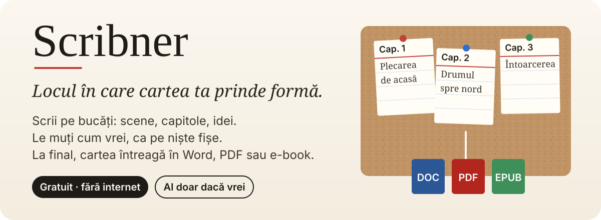
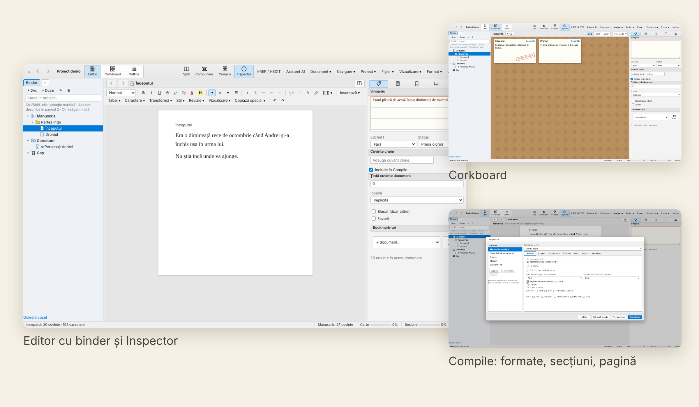

<p align="center">
  
</p>

<p align="center">
  
</p>

Scribner este un program de scris pentru texte lungi: romane, non-ficțiune, teze, scenarii. Organizezi textul în bucăți mici pe care le muți liber, apoi îl compilezi într-un singur manuscris. Este scris de la zero după funcțiile Scrivener 3, fără cod din Scrivener, și deschide proiectele tale `.scriv` fără să piardă nimic.

AI-ul este opțional. Toate funcțiile merg fără el, iar comutatorul din Setări îl oprește complet.

## Cum lucrezi

<p align="center">
  
</p>

**Importă.** Proiecte Scrivener 1/2/3 cu tot ce conțin: text, note, sinopsis, etichete, status, cuvinte cheie, metadate, colecții, snapshot-uri, istoric și media. Plus Word, RTF, ODT, HTML, Markdown, Fountain, Final Draft, OPML, pagini web și bibliografii Zotero.

**Scrie.** Binder cu Manuscris, Cercetare și Coș; Scrivenings, split editor, corkboard, outline, Inspector. Comentarii, note de subsol, stiluri, mod compunere, ținte de cuvinte, snapshot-uri cu diff, căutare și înlocuire în tot proiectul, Script Mode pentru scenarii.

**Revizuiește.** I-REP găsește și repară problemele de tipografie și stil, apoi reverifică. I-EDIT rulează runde editoriale. Profilul implicit „Generic” merge pe orice text; profilul „Română” aplică DOOM III și regulile P1–P13 / R0–R11.

**Compilează.** Formate editabile (manuscris standard, carte tipărită, e-book), secțiuni, pagină de titlu, cuprins, note de subsol sau de final, antet și subsol. Ieșire în DOCX, PDF, EPUB, HTML, RTF, ODT, Markdown, LaTeX sau înapoi în `.scriv`.

## Pornire

Ai nevoie de Node.js 22+.

```bash
npm install
npm start          # construiește și pornește aplicația
npm run dist:win   # creează Scribner.exe portabil în release/
```

Versiunea portabilă își ține setările lângă `.exe`, în `Scribner-data/`, deci merge de pe stick.

`npm run dev` deschide interfața în browser. Cu `?demo` la finalul adresei pornește un proiect demonstrativ în memorie.

## Ce mai are

<details>
<summary><strong>Asistent AI (orice furnizor)</strong></summary>

Alegi furnizorul în Setări → AI și pui cheia lui API: Anthropic (Claude), OpenAI, Google Gemini, OpenRouter, Mistral, Groq, DeepSeek, xAI, un model local prin Ollama sau LM Studio (fără cheie), sau orice server compatibil OpenAI cu URL propriu. Modelul îl scrii tu, exact cum îl numește furnizorul. Fiecare furnizor are cheia lui; cheile sunt criptate de sistemul de operare și rămân în procesul principal, interfața vede doar dacă o cheie există. Butonul „Testează conexiunea” trimite o cerere minimă și arată răspunsul sau eroarea.

Asistentul face corectură, sinopsis, continuare în stilul tău, critică și verificare de consistență. În bloc: sinopsis pentru toate documentele, fișe de personaje care se actualizează, revizie pe niveluri de la carte la frază. Cercetarea în proiect (RAG) folosește același furnizor pentru răspunsuri.

**NotebookLM.** NotebookLM nu are API public pentru conturile personale, așa că Unelte → Exportă pentru NotebookLM… scrie folderul `NotebookLM - <Titlu>`: un fișier Markdown pe capitol (dosarele de prim nivel din Manuscris), cercetarea și notele ca surse separate și un cuprins cu sinopsisurile. Exportul respectă limita de 50 de surse și împarte fișierele foarte lungi. Încarci fișierele în notebook; Unelte → Deschide NotebookLM deschide notebook-ul al cărui link l-ai pus în Setări (sau pagina principală).

</details>

<details>
<summary><strong>Agenți AI prin MCP</strong></summary>

Serverul `mcp/server.mjs` dă acces la un proiect oricărui client MCP (Claude Code, Claude Desktop, Cursor, VS Code, Gemini CLI, alți agenți), indiferent de modelul din spate: citire și scriere, binder, căutare, metadate, note, comentarii, I-REP, snapshot-uri, Compile. Fiecare scriere face snapshot înainte și se notează în `agent-log.jsonl`. Exemplu cu Claude Code:

```bash
claude mcp add scribner -- node "/cale/Scribner/mcp/server.mjs" --project "/cale/Cartea mea.scribner"
```

`--read-only` permite doar citirea. Alți clienți primesc aceeași comandă (`node mcp/server.mjs --project …`) în configurația lor de servere MCP. Comanda exactă apare în Setări → Conexiune MCP.

</details>

<details>
<summary><strong>Unelte de scriitor</strong></summary>

Cronologie, hartă de relații între personaje, analiză de ritm, generator de nume, Scratchpad, citire cu voce tare, dictare, cercetare locală în proiect, Quick Reference, layouts salvate, scurtături configurabile, ferestre multiple, interfață în română și engleză.

</details>

<details>
<summary><strong>Formatul proiectului</strong></summary>

```text
Cartea mea.scribner/
  project.json           binder, etichete, statusuri, ținte, setări Compile
  docs/<id>.html         textul fiecărui document
  notes/<id>.html        notele
  snapshots/<id>/*.json  snapshot-urile
  media/                 imagini, PDF, audio
```

Fișiere text simple: le poți versiona cu git sau sincroniza cu orice cloud. Sincronizarea cu un folder extern și exportul ca pachet pentru versiunea web sunt în meniul Fișier.

</details>

## Stare

Testele (`npm test`, 348) acoperă importul Scrivener, RTF, Compile, I-REP, serverul MCP și restul bibliotecilor. Planul complet și ce rămâne de verificat sunt în [`ROADMAP.md`](ROADMAP.md). `npm run test:e2e` pornește aplicația reală în Electron: creează un proiect, scrie, compilează DOCX/PDF/EPUB, exportă `.scriv` și îl reimportă. Verificat pe Linux; neverificat încă pe Windows și pe un proiect Scrivener real mare.

## Licență

MIT. Vezi [`LICENSE`](LICENSE).
