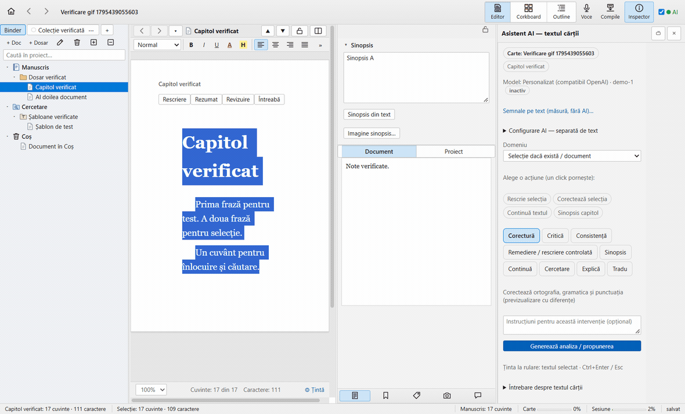
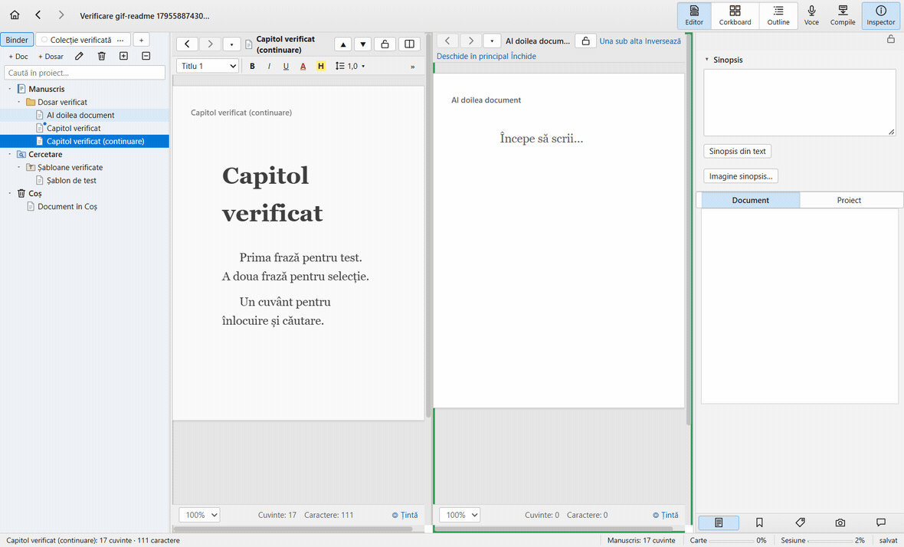
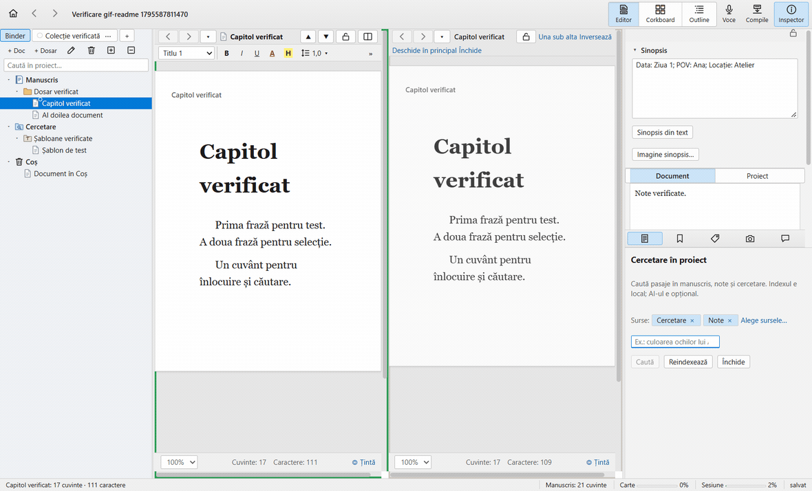
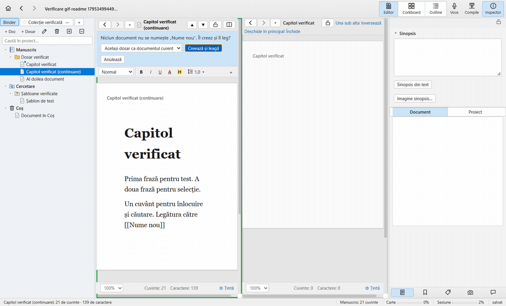
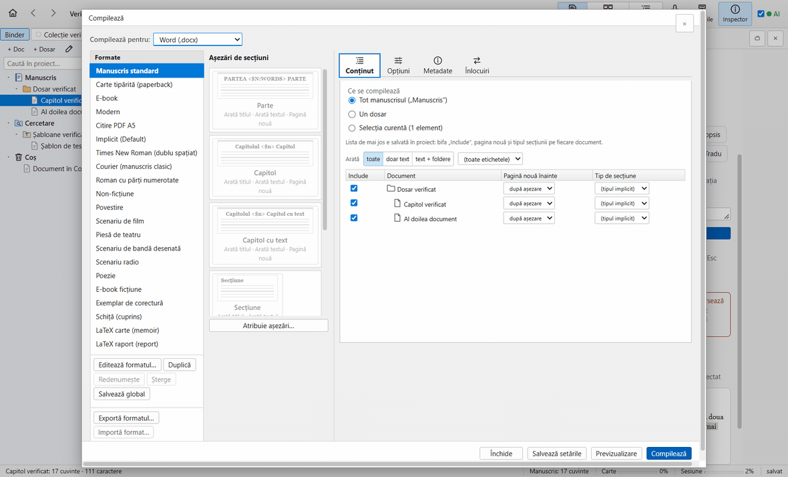

# Pneuma Sofer

**Pneuma Sofer este un mediu desktop pentru scriere, traducere, cercetare și organizarea documentelor ample.** Lucrezi local cu manuscrise împărțite în scene, capitole, note și materiale de referință, apoi compilezi rezultatul într-un fișier final.

Este destinat în special **scriitorilor, traducătorilor, cercetătorilor, autorilor academici și tehnici, documentariștilor** și tuturor celor care lucrează cu proiecte lungi, versiuni succesive și documente interconectate.

> **Fluxul de bază:** creezi sau imporți un proiect → organizezi fișele → redactezi și revizuiești → păstrezi referințele aproape → cauți și verifici legăturile → compilezi rezultatul.

## Pentru cine este aplicația

Pneuma Sofer este utilă atunci când lucrarea are multe documente, versiuni, surse sau relații între fragmente. Nu este limitată la un singur gen:

### Scriitori de ficțiune

Organizezi scene, capitole, personaje și fire narative în Binder, le reordonezi pe Corkboard și păstrezi cronologii, note și versiuni de lucru lângă manuscris.

### Autori de nonficțiune

Separi capitolele de notele de lucru și materialele documentare, păstrezi sursele în proiect și revizuiești textul înainte de compilarea unei ediții.

### Traducători literari

Ții originalul și documentul tradus în panouri alăturate, compari fragmentele și păstrezi notele de traducere în același proiect. Traducerea automată depinde de serviciul configurat și nu este demonstrată de GIF-ul side-by-side.

### Traducători tehnici

Poți organiza documentația sursă, variantele traduse, glosarele proprii și referințele ca documente separate. README-ul nu prezintă o memorie de traducere sau o bază terminologică specializată ca funcție garantată.

### Cercetători și autori de studii

Păstrezi întrebările, sursele, notele și materialele media într-o structură navigabilă, apoi cauți în proiect și legi documentele între ele. Rezultatele RAG și citările verificate depind de configurarea cercetării și nu sunt pretinse de captura Research.

### Autori academici și științifici

Lucrezi cu capitole, versiuni, note, comentarii, referințe și materiale de lucru într-un singur proiect. Citările academice structurate, paginarea finală și formatarea cerută de o publicație trebuie verificate în formatul exportat.

### Autori tehnici și de tratate

Folosești ierarhia Binderului, stilurile, documentele alăturate, căutarea și Compile pentru lucrări lungi cu structură repetabilă și multe anexe sau materiale de referință.

### Jurnaliști și documentariști

Păstrezi interviuri, fragmente, documente și piste de documentare în dosare separate, legi informațiile relevante și construiești textul final din documentele incluse în Compile.

### Proiecte editoriale complexe

Pentru manuale, rapoarte, colecții sau proiecte cu mai mulți pași editoriali, aplicația oferă o structură locală, snapshot-uri, revizii, căutare, cronologie și export. Sincronizarea prin cloud rămâne la nivel de fișiere și nu este colaborare real-time.

## Începe în 60 de secunde

1. Descarcă versiunea Windows din [ultima versiune publică](https://github.com/Hermeneuticus-of-things/Scriptorium/releases/latest). Versiunea sursă verificată pentru această pagină este **v1.4.2**.
2. Creează un proiect sau importă un document existent.
3. Folosește binderul pentru a separa manuscrisul în scene, capitole, dosare, note și surse.
4. Scrie în editor, deschide documente alăturate ca referință și verifică versiunile înaintea modificărilor importante.
5. Deschide **Fișier → Compilează…**, alege conținutul și formatul, verifică previzualizarea și exportă.

## Organizare: fișe, dosare și structură

Binderul păstrează proiectul într-o structură de documente. Poți crea dosare și documente, muta fișe, redenumi elemente, folosi etichete și statusuri, include sau exclude documente din Compile și păstra materiale de cercetare separat de manuscris.

Corkboard-ul afișează documentele ca fișe cu titlu și sinopsis. Ordinea se poate schimba prin tragere, iar Outline-ul oferă o vedere tabelară asupra structurii și metadatelor.

<p align="center">
  
</p>

## Redactare și revizuire în editor

Editorul suportă formatare de text, stiluri, liste, tabele, imagini, note, comentarii, adnotări, revizii și vizualizări pentru scriere. Poți împărți editorul în două panouri, păstra un document ca referință și folosi snapshot-uri pentru revenire la o versiune anterioară.

Funcțiile locale de scriere și organizare nu cer AI și nu trimit automat textul către un serviciu extern.

### Reparații fără AI și măsurători

**Reparații simple** și **Semnale pe text** sunt unelte locale, fără model AI. Ele pot semnala sau repara operații mecanice, precum spații duble, ghilimele și anumite probleme de formatare. Semnalele sunt indicii pentru autor, nu verdict automat asupra calității unui text.

<p align="center">
  
</p>

### AI opțional, separat de Inspector

Dacă activezi un furnizor compatibil, fereastra AI poate transmite textul selectat, afișa răspunsul în streaming și prezenta diferențele înainte de acceptare. Captura folosește un server mock local pentru a demonstra fluxul UI; nu este o evaluare a unui furnizor sau a calității unei corecturi.

<p align="center">
  
</p>

## Referințe și documente alăturate

Deschide un document ca **referință** lângă editor pentru a consulta un plan, o scenă veche, o notă sau originalul unei traduceri. Referința poate rămâne doar pentru citire; editarea ei este o alegere separată.

<p align="center">
  
</p>

## Traducere

Pentru traducere, poți ține originalul și documentul de lucru în două panouri ale editorului. Instrumentele DeepL, Google și dicționarele depind de configurarea serviciului, de cheie sau cont și de conectivitate. Imaginea de mai jos demonstrează numai fluxul side-by-side și încărcarea documentului alăturat; nu este o garanție asupra calității unei traduceri automate.

<p align="center">
  
</p>

Pneuma Sofer **nu trebuie confundat cu un sistem complet de memorie de traducere sau cu o bază terminologică specializată**. Aceste capabilități nu sunt prezentate ca funcții locale garantate ale versiunii curente.

## Cercetare și documentare

În zona **Cercetare** poți păstra documente, note și materiale media ale proiectului. Panoul de cercetare permite formularea unei întrebări și alegerea documentelor sau dosarelor incluse în scope. Captura de mai jos arată întrebarea și sursa selectată; nu prezintă un răspuns AI sau citări ca fiind verificate.

<p align="center">
  
</p>

Importul de pagini web și materiale locale depinde de format, de sistem și de operația concretă. **Adnotarea PDF direct în viewer nu este disponibilă în versiunea curentă**; PDF-urile pot fi păstrate și vizualizate ca materiale de referință.

## Căutare în proiecte mari

Căutarea rapidă și căutarea avansată pot găsi documente după titlu, text, sinopsis, note și metadate, în funcție de opțiunea aleasă. Rezultatele pot fi folosite pentru navigare și pentru operații de înlocuire cu snapshot înaintea modificărilor importante.

**Ctrl+Shift+H** deschide Help Finder pentru articole și comenzi. Demonstrația arată introducerea unei întrebări și afișarea rezultatelor, nu executarea automată a unei comenzi.

<p align="center">
  
</p>

Pentru utilizare fără mouse, **F6** mută focusul între panourile vizibile. GIF-ul demonstrează mutarea focusului; nu pretinde că toate combinațiile de tastatură sunt certificate pentru orice temă sau sistem de operare.

<p align="center">
  
</p>

## Legături între documente și cronologie

Scrierea `[[Titlu]]` poate crea o legătură internă către un document existent. Pentru un titlu care nu există, aplicația poate propune crearea unui document nou și legarea lui.

<p align="center">
  
</p>

Cronologia folosește câmpuri de dată și metadate precum POV sau locație pentru a așeza scenele pe o axă. Este un instrument de verificare a consecvenței, nu un sistem automat care decide dacă povestea este corectă.

<p align="center">
  
</p>

## Compilare și export

**Fișier → Compilează…** adună documentele incluse și oferă previzualizare înainte de export. Poți modifica selecția de conținut, alege un format și verifica rezultatul.

<p align="center">
  
</p>

<p align="center">
  
</p>

Formatele de import, export și Compile sunt documentate în [inventarul funcțiilor](docs/FEATURES.md). În funcție de operație, versiune și dependențele instalate, sunt disponibile formate precum DOCX, PDF, EPUB, HTML, RTF, ODT, Markdown, text simplu, Fountain, Final Draft și proiectul `.scriv`.

Importul `.scriv` are raport de conversie și păstrează copia originală, dar **„fără pierderi” nu trebuie presupus pentru orice proiect real**; verifică raportul și round-trip-ul pentru materialul tău.

## Dictare și transcriere

Dictarea și transcrierea există ca funcții condiționate de motorul audio configurat, microfon și sistemul de operare. Pot folosi un motor local sau D&TED, conform [documentației D&TED](docs/DTED.md). Nu prezentăm dictarea live prin GIF deoarece aceasta cere hardware și un mediu local verificabil.

Actualizarea automată a D&TED din Pneuma Sofer este **planificată și nu trebuie considerată disponibilă**. Instalarea sau actualizarea dependenței se face separat până când fluxul va fi implementat și validat.

## Funcții disponibile, limitate și planificate

### Disponibile și verificabile în cod și teste

- proiecte locale cu binder, dosare, documente, Corkboard și Outline;
- editor cu formatare, stiluri, note, comentarii, adnotări, snapshot-uri și revizii;
- căutare în proiect, înlocuire și navigare între documente;
- legături interne `[[Titlu]]`, panouri split și Quick Reference;
- cronologie pe baza metadatelor documentelor;
- Compile și export în formatele suportate de implementarea curentă;
- backup local și sincronizare prin folder extern;
- server MCP și CLI, cu permisiuni configurabile.

### Disponibile cu limitări sau condiții

- AI, traducere online, dicționare și întrebări pe surse: necesită configurare, servicii externe, chei/conturi sau conectivitate;
- dictare și transcriere: necesită motor, model, microfon și permisiuni locale;
- import/export `.scriv`: verifică raportul de conversie și elementele neconvertibile;
- sincronizare prin folder/cloud/NAS: este sincronizare la nivel de fișiere, nu colaborare simultană real-time;
- paginare exactă, formate și compatibilitate: verifică fișierul produs în aplicația sau cititorul țintă;
- MCP cu scriere: activează-l numai pentru proiectul dorit, după testare în `--read-only`.

### Planificate sau neimplementate

- colaborare real-time cu cursoare, roluri, sugestii și coadă offline;
- adnotări PDF directe și persistente în viewer;
- export în masă al snapshot-urilor;
- paritate completă pentru toate opțiunile fine de Compile/Print;
- actualizare integrată D&TED;
- semnarea Authenticode a installerului.

Statusul detaliat și criteriile de acceptare sunt în [ROADMAP.md](ROADMAP.md), iar inventarul funcțional în [docs/FEATURES.md](docs/FEATURES.md).

## Sincronizare și siguranță

Datele proiectului sunt locale. Un folder sincronizat prin OneDrive, Dropbox, Google Drive sau NAS poate fi deschis pe rând pe mai multe calculatoare, dar furnizorul poate produce copii de conflict. Pneuma Sofer nu pretinde îmbinare automată a paragrafelor și nu oferă prezență live în versiunea curentă.

### AI și MCP sunt opționale

AI-ul din aplicație este separat de Inspector și propune rezultate care trebuie citite și acceptate de autor. Furnizorii externi pot primi textul selectat sau contextul cerut de operație; verifică setările și politica furnizorului înainte de utilizare.

MCP este o integrare pentru clienți externi precum Claude Desktop, Claude Code, Codex, Cursor, Gemini CLI sau VS Code. Începe cu modul read-only și limitează proiectul:

```bat
claude mcp add pneuma --scope user -- cmd /c %LOCALAPPDATA%\Programs\Pneuma Sofer\pneuma-mcp.cmd --read-only
```

Pentru permisiuni, tokenuri, anonimizare și acces limitat la proiect, consultă [docs/MCP_ARHITECTURA.md](docs/MCP_ARHITECTURA.md).

## Instalare

Descarcă [ultima versiune din GitHub Releases](https://github.com/Hermeneuticus-of-things/Scriptorium/releases/latest):

- `PneumaSofer-Setup-<versiune>.exe` — instalare Windows;
- `PneumaSofer-<versiune>-portabil.exe` — rulare fără instalare.

Verifică `SHA256SUMS` din Release înainte de instalare dacă distribuiești aplicația într-un mediu important. Installerul este nesemnat digital în versiunea curentă, deci Windows poate afișa SmartScreen.

Pentru dezvoltare:

```bash
git clone https://github.com/Hermeneuticus-of-things/Scriptorium.git
cd Scriptorium
npm ci
npm start
npm test
npm run test:e2e
```

Capturile GIF din README se regenerează numai din aplicația Electron reală, cu fixture izolat:

```powershell
npm run build
$env:SCRIBNER_NO_UPDATE_CHECK='1'
node tests/e2e/gif-readme.cjs
node tests/e2e/gif-features.cjs
```

Procesul și limitările sunt documentate în [docs/readme-gif-uri.md](docs/readme-gif-uri.md). Toate GIF-urile din această pagină pornesc automat, au loop infinit și au fost verificate pentru cadre, dimensiune și markerul Netscape.

## Documentație

- [Schimbări](CHANGELOG.md)
- [Roadmap și limite](ROADMAP.md)
- [Inventarul funcțiilor](docs/FEATURES.md)
- [Arhitectură](docs/ARCHITECTURE.md)
- [MCP](docs/MCP_ARHITECTURA.md)
- [Dictare și D&TED](docs/DTED.md)
- [Procesul GIF-urilor](docs/readme-gif-uri.md)
- [Licență](LICENSE)

## Licență

MIT. Vezi [LICENSE](LICENSE).
